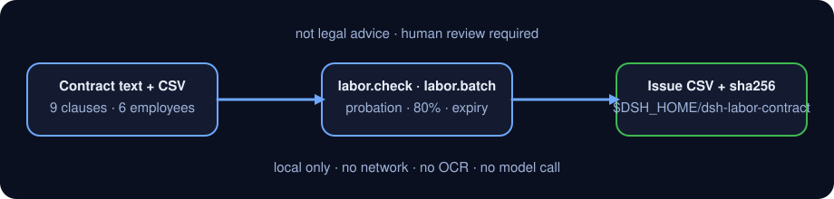

<div align="center">

# dsh-labor-contract

> **官方仓库。** 本包唯一官方仓库，由 PerryLink 维护；其他账号下的同名仓库与本项目无关。Apache-2.0。

[](https://www.npmjs.com/package/dsh-labor-contract)
[](https://github.com/PerryLink/dsh-labor-contract/actions)
[](LICENSE)

**劳动合同条款覆盖 + 试用期上限 + 试用期工资 80% + 批量到期体检。本地运行，不构成法律意见。**

> **状态：alpha / 公开合成 / partial / not counted / 非 GA。** 不含客户数据、客户合同或真实员工信息，也不作生产可用或法律合规声明。

[English](README.md) · [简体中文](README-zh.md)

```sh
dsh plugin --profile <profile> add dsh-labor-contract
```

</div>

## 一句话

把一份劳动合同的正文和一份员工合同 CSV 变成一张可复核的清单：哪些必备条款没写、试用期有没有超上限、试用期工资够不够 80%、哪些合同已经到期或快到期，最后导出一份 CSV。

> 只做**条款覆盖、日期和比例**的核对；**不是法律意见**，也不判断具体条款是否有效。

## 适合 / 不适合

- **适合**：HR / 法务在签前做一次结构化自查；批量检查 6～500 人的合同到期、试用期和试用期工资；把问题清单交给业务或律师复核；作为合同台账的输入。
- **不适合**：替代律师出具法律意见；判断条款效力、违约金、股权、保密、知识产权归属；从 PDF/扫描件/DOCX 直接读合同（本包只吃纯文本）；核对当地最低工资、社保基数或个税（这些要按城市和年度另行核对）。

## 输入

- `labor.check`：一段劳动合同**纯文本**（`.txt` / 粘贴的正文）。如果手上是 PDF、扫描件或 DOCX，请先用你信任的工具转成文本；本包不做 OCR，也不解析二进制文档。
- `labor.batch`：一份 UTF-8 CSV，表头固定为
  `employee,position,contract_start,contract_end,probation_months,monthly_salary,probation_salary`。
  - `probation_salary` 可省略；省略时无法做 80% 比例检查。
  - 日期必须是 `YYYY-MM-DD`；`contract_end` 也可以写 `无固定期限`。
  - 金额写 `1234.56`，不要带 `¥`、空格或中文单位。
- `labor.export`：一组问题行（通常直接传 `labor.batch` 的 `issues`）和一个安全文件名。
- 所有输入只读；不会修改你的合同或 CSV。

## 输出

- `labor.check`：`clauses`（9 项，每项 `present` / `attention` / `missing` + 证据句 + 提示）、`summary`、`term`、`probation`、`probation_pay`、`non_compete`，以及 `disclaimer_zh`。
- `labor.batch`：`as_of`、`rows`、`issues`、`due.expired` / `due.expiring`、`summary.by_code`。
- `labor.export`：CSV 路径、行数、字节数、`sha256`。文件写到 `$DSH_HOME/dsh-labor-contract/exports/`。
- 所有日期都是 `YYYY-MM-DD`；金额在内部按分计算，避免浮点误差。

## 示例

把下面这句直接发给 agent：

> 帮我核对这份劳动合同的必备条款、试用期上限和试用期工资比例，再把 6 名员工的合同批量查一遍到期和试用期问题。

复跑自带样例并核对金标：

```sh
node samples/quickstart/run.mjs --check
```


样例是一份 36 个月的合成合同 + 6 名合成员工：9 项条款全部命中；试用期 3 个月（上限 6 个月）；试用期工资 10800 / 12000 = 90%；竞业限制 2 年且有补偿。批量结果 4 个问题：1 个试用期超限、1 个合同已到期、1 个试用期工资 79.99%、1 个 74 天后到期。金标 `samples/quickstart/expected/result.json` 由 `node samples/quickstart/run.mjs --json` 真实产生，不是手写。

## 权限

读：用户指定的劳动合同文本与员工合同 CSV（样例 `samples/quickstart/input/`）；不读其他目录。
写：`$DSH_HOME/dsh-labor-contract/exports/`（仅 `labor.export`）；不改原合同与 CSV。
联网：否。
外部系统：无。

`labor.check`、`labor.batch` 是 **R0**（只读）；`labor.export` 是 **R1**（本地写，只写 `$DSH_HOME/dsh-labor-contract/exports/`）。可用 `DSH_LABOR_CONTRACT_HOME` 覆盖本地写根目录（测试用），默认严格等于 `$DSH_HOME/dsh-labor-contract`。

## 工具

工具名是稳定 API；说明保留英文以匹配运行时输出。

| 工具 | 用途 | 风险 |
|---|---|---|
| `labor.check` | 9 项必备条款覆盖 + 试用期上限 + 试用期工资 80% + 竞业限制补偿提示 | R0 |
| `labor.batch` | CSV 批量：试用期超限、合同到期/90 天内到期、试用期工资 <80% | R0 |
| `labor.export` | 把问题清单写成带引号转义的 CSV，返回路径与 sha256 | R1 local write |

### 9 项必备条款

合同期限、工作内容、工作地点、工时与休息休假、劳动报酬、社会保险、劳动保护与劳动条件、解除与终止、争议解决。

每项三种状态：

- `present`：找到条款，且看到具体要素（日期、岗位、城市、金额、险种、通知期/补偿、仲裁路径等）。
- `attention`：找到条款关键词，但缺少具体要素（例如只有“合同期限”四个字，没有起止日期）。
- `missing`：整段没有找到该条款关键词。

这是关键词 + 句式启发式，**不是**合同解释。条款写得再漂亮，也不代表它合法有效；反过来，换一种写法也可能被误判，需要人工复核。

### 试用期上限

按合同期限的整数月（含结束日）判断：

| 合同期限 | 试用期上限 |
|---|---|
| 不满 3 个月 | 不得约定试用期 |
| 3 个月以上不满 1 年 | 1 个月 |
| 1 年以上不满 3 年 | 2 个月 |
| 3 年以上 / 无固定期限 | 6 个月 |
| 以完成一定工作任务为期限 | 不得约定试用期 |

边界按含结束日的整月计算：2026-01-01 至 2026-03-31 算 3 个月，2026-01-01 至 2026-03-30 算 2 个整月。识别不到合同期限时返回 `unknown`，不会猜。

### 试用期工资 80%

`labor.check` 从文本里找“试用期工资”“转正后月工资 / 月工资”，按分比较：`试用期工资 × 100 < 约定工资 × 80` 才算低于 80%，正好 80% 通过。`labor.batch` 对每一行做同样比较。**同时还要满足当地最低工资标准**，这个本包不知道，需要你按城市核对。

### 竞业限制补偿提示

文本里出现“竞业限制 / 竞业禁止”时，检查是否同时写了按月经济补偿，以及期限是否超过 2 年；两者任一不满足就标 `attention`。提示不构成对竞业限制效力的判断。

### 批量到期

`labor.batch` 以 `as_of`（默认当天）为基准：

- `contract_end < as_of`：`CONTRACT_EXPIRED`，进入 `due.expired`。
- `0 ≤ contract_end - as_of ≤ 90`：`CONTRACT_EXPIRING`，进入 `due.expiring`。
- `contract_end = 无固定期限`：不参与到期判断，试用期上限按 6 个月。

90 天是本包自定的提醒窗口，不是法定值；可以按你的续签流程改脚本里的 `EXPIRING_WINDOW_DAYS` 后重新构建。

## CSV 格式

| 列 | 必填 | 说明 |
|---|---|---|
| `employee` | 是 | 员工姓名或编号 |
| `position` | 是 | 岗位 |
| `contract_start` | 是 | `YYYY-MM-DD` |
| `contract_end` | 是 | `YYYY-MM-DD` 或 `无固定期限` |
| `probation_months` | 是 | 非负整数，单位月 |
| `monthly_salary` | 是 | 转正后约定月工资，元，最多两位小数 |
| `probation_salary` | 否 | 试用期月工资；省略则跳过 80% 检查 |

```csv
employee,position,contract_start,contract_end,probation_months,monthly_salary,probation_salary
陈一（合成）,前端工程师,2026-01-01,2028-12-31,3,12000,10800
```

## FAQ

### 1. 这是法律意见吗？

不是。它只做条款覆盖、日期和比例的格式核对，返回 `disclaimer_zh` 明确说明；具体合规请咨询执业律师或当地人力资源社会保障部门。

### 2. 能直接读 PDF / DOCX / 扫描件吗？

不能。本包只接收纯文本。请先用你信任的工具把合同转成文本；扫描件还需要先 OCR。本包不联网、不调用 OCR 服务。

### 3. 试用期按自然月还是按天算？

按含结束日的整月算。`contractTermMonths` 的规则：结束日加一天后做月差，再按日修正；`2026-01-01` 至 `2026-03-31` = 3 个月。试用期本身支持“X 个月 / X 天 / X 年”，天按 30 天/月折算，因此 45 天会按 1.5 个月与上限比较。

### 4. 80% 是税前还是税后？

本包只比较文本里的两个约定金额，不区分税前税后，也不扣社保、公积金和个税。请用合同里的同一口径填写 `monthly_salary` 和 `probation_salary`。

### 5. 到期窗口为什么是 90 天？

这是本包默认的续签提醒窗口，不是法定值。改 `src/core/labor.ts` 里的 `EXPIRING_WINDOW_DAYS`、重新 `pnpm build` 即可；金标与截图需要同步重跑。

### 6. 会把合同上传或调用模型吗？

不会。三个工具都是本地代码；不联网、不上传、不调用模型。`labor.export` 只写 `$DSH_HOME/dsh-labor-contract/exports/`。

## 版本

`0.1.0-alpha.1` · 31 项测试通过（`node --test test/*.test.mjs`）。

> ⭐ 如果它帮到了你，点个 star 会让下一个人更容易找到它；没有任何功能被 star 解锁。



*工作流：本地合同文本 + 员工 CSV → 条款/试用期/80%/到期检查 → 本地问题清单 CSV；不联网、不调用模型。*

## 安装

```sh
dsh plugin --profile <profile> add dsh-labor-contract
dsh --profile <profile> --dump-config | grep dsh-labor-contract
```

卸载：

```sh
dsh plugin --profile <profile> remove dsh-labor-contract
```

### 安装通道

- **npm（推荐）:** `dsh plugin --profile <profile> add dsh-labor-contract`
- **git 通道:** `dsh plugin --profile <profile> add github:PerryLink/dsh-labor-contract`
- **tarball:** `pnpm pack`，然后 `dsh plugin --profile <profile> add ./dsh-labor-contract-<version>.tgz`

## 快速开始

```sh
# 1) 单份合同体检
#    工具面：labor.check({ text: "<合同正文>" })

# 2) 批量核对
#    工具面：labor.batch({ csv: "<CSV 文本>", as_of: "2026-11-02" })

# 3) 导出问题清单
#    工具面：labor.export({ issues: [...labor.batch 的 issues], filename: "labor-issues.csv" })
```

用样例直接跑：

```sh
node samples/quickstart/run.mjs --check
```

## 验收证据

公开/合成 fixture 在 `samples/quickstart/`；`ACCEPTANCE.csv` 记录检查，除 quickstart 行外均为 `counted=false`。

| req_id | metric | threshold | actual | pass | source | counted |
|---|---|---|---|---|---|---|
| LABOR-A01 | nine required clauses present | 9/9 | 9/9 | true | public/synthetic | false |
| LABOR-A03 | probation cap boundary | ok/over/over | ok/over_limit/over_limit | true | public/synthetic | false |
| LABOR-A04 | 80% probation-pay boundary | ok/below_80 | ok/below_80 | true | public/synthetic | false |
| LABOR-A05 | 6-person batch issues | 4 | 6rows/4issues | true | public/synthetic | false |
| LABOR-A07 | invalid date error | E_LABOR_DATE_INVALID | E_LABOR_DATE_INVALID | true | public/synthetic | false |
| PS1-QS01 | quickstart 样例与金标一致 | 1/1 | 1 | true | synthetic/quickstart | true |

*这是 fixture 支撑的验收行，不是客户运行；没有编造输出。*

## 边界与已知限制

- **不是法律意见**：不判断条款效力、不计算经济补偿/赔偿金、不替代律师。
- **只吃文本**：不解析 PDF/DOCX/扫描件；不做 OCR。
- **关键词启发式**：同义写法、表格排版、条款合并可能造成 `present` / `attention` / `missing` 误判，必须人工复核。
- **试用期上限按合同期限**：不处理“同一用人单位与同一劳动者只能约定一次试用期”、劳务派遣、非全日制等特殊规则。
- **80% 只比较合同里的两个金额**：不知道当地最低工资、社保基数、个税和税前/税后口径。
- **竞业限制只提示补偿和 2 年上限**：不判断人员范围、地域、业务范围是否合理。
- **90 天到期窗口是自定值**：不是法定通知期。
- **CSV 只做 RFC 4180 引号转义**：不做 Excel 公式前缀清洗；不要用 Excel 直接打开来源不明的 CSV。
- 仅公开/合成样例；alpha/partial、not counted，不作 GA 或生产可用声明。

## 开发

```sh
pnpm install --frozen-lockfile
pnpm build && pnpm lint && pnpm typecheck
node --test test/*.test.mjs
node scripts/gate.mjs
```

## 兼容性

| 维度 | 状态 |
|---|---|
| Harness | `dsh >=0.2.1-rc.3 <0.4.0` |
| Node | `>=24.9.0 <25` |
| Platforms | All; local files only |
| 数据 | No network, no model call, no upload |

## 相关项目

- [dsh-legal-intake](https://github.com/PerryLink/dsh-legal-intake)（合同/需求邮件收件与台账）
- [dsh-contract-renewal](https://github.com/PerryLink/dsh-contract-renewal)（合同到期 / 续签窗口看板）
- [dsh-pim-lint](https://github.com/PerryLink/dsh-pim-lint)（CSV 校验类工具）
- [领域索引](https://perrylink.github.io/dsh-plugins/)

## 许可证

Apache-2.0. See `LICENSE`, `NOTICE`, `THIRD-PARTY-NOTICES`.
