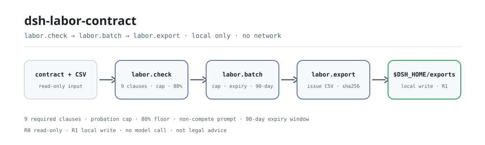

<div align="center">

<picture>
  <source media="(prefers-color-scheme: dark)" srcset="docs/assets/dsh-labor-contract-flow-dark.svg">
  
</picture>

# dsh-labor-contract

**Turn one labor-contract text and one employee CSV into a reviewable issue list: missing required clauses, an over-cap probation, probation pay below 80%, and contracts expired or expiring soon — then export the list as CSV.**

A purely local contract review plugin for HR and legal ops: nine required clauses, the probation cap, the 80% probation-pay floor, batch expiry and a non-compete compensation prompt, with a sha256-stamped CSV export — no network, no model call, not legal advice.

[Install](#three-step-setup) · [Configuration](#configuration) · [FAQ](#faq) · [简体中文](README.md) · [English](README.en.md) · [Español](README.es.md) · [Português](README.pt.md) · [हिन्दी](README.hi.md)

[](LICENSE)
[](#compatibility)
[](https://www.npmjs.com/package/dsh-labor-contract)
[](https://github.com/PerryLink/dsh-labor-contract/actions/workflows/ci.yml)
[](#compatibility)

[](https://github.com/PerryLink/dsh-labor-contract/stargazers)
[](https://www.npmjs.com/package/dsh-labor-contract)
[](https://dshfind.com/plugins/PerryLink/dsh-labor-contract?ref=badge)
[](https://gitee.com/perrylink/dsh-labor-contract)

```sh
dsh plugin --profile <profile> add dsh-labor-contract
```

</div>

<sub>Community plugin, not affiliated with DeepSeek. Canonical repository: <https://github.com/PerryLink/dsh-labor-contract> (Gitee is a mirror). Status: alpha / public-synthetic / partial / not counted / not GA — no customer contracts or real employee data, and no production-readiness or legal-compliance claim.</sub>

## What it is

`dsh-labor-contract` reads one labor contract as plain text, checks coverage of the nine required clauses, derives the probation cap from the contract term, compares probation pay against the 80% floor, and prompts for non-compete compensation and the two-year limit. It also batch-checks an employee contract CSV: probation over the cap, contracts expired or expiring within 90 days, and probation pay below 80%. Finally it writes the issue list as a CSV with a `sha256` receipt.

It checks **clause coverage, dates and ratios** only: everything runs on your machine, the source files stay read-only, and there is no network or model call.

- **Fits:** a structured pre-signing self-check by HR or legal ops; batch checks for 6–500 employees; handing a structured issue list to a reviewer; feeding a contract register.
- **Does not fit:** replacing a lawyer; deciding validity, penalties, equity, confidentiality or IP ownership; reading PDFs, scans or DOCX directly (text only); checking local minimum wage, social-insurance base or payroll tax.

## Three-step setup

1. **Install** (pick one channel):

   ```sh
   # npm channel (recommended, published releases)
   dsh plugin --profile <profile> add dsh-labor-contract
   # git channel (latest main; same as git+https://github.com/PerryLink/dsh-labor-contract.git)
   dsh plugin --profile <profile> add github:PerryLink/dsh-labor-contract
   # tarball channel: pnpm pack in this repo, then
   dsh plugin --profile <profile> add ./dsh-labor-contract-<version>.tgz
   ```

   There is no build step; the installed `lib/` is the shipped artifact.

2. **Verify it is live**:

   ```sh
   dsh --profile <profile> --dump-config | grep dsh-labor-contract
   ```

3. **Run the bundled sample** (run `pnpm build` in this repo first; one synthetic 36-month contract + six synthetic employees, compared against the golden file):

   ```sh
   node samples/quickstart/run.mjs --check
   ```

**Uninstall:** `dsh plugin --profile <profile> remove dsh-labor-contract` (or delete the line from the profile patch).

## Core capabilities

Tool names are stable API; descriptions stay in English to match runtime output.

| Tool | Purpose | Risk |
|---|---|---|
| `labor.check` | One contract: nine required clauses + probation cap + 80% probation pay + non-compete compensation prompt | R0 (read-only) |
| `labor.batch` | CSV batch: over-cap probation, expired / 90-day expiring contracts, probation pay below 80% | R0 (read-only) |
| `labor.export` | Write the issue list as quoted CSV; return path and sha256 | R1 (local write under exports only) |

- **Nine required clauses:** term, duties, location, hours/rest, pay, social insurance, labor protection, termination, dispute resolution — each with an evidence sentence and `present` / `attention` / `missing`.
- **Probation cap:** 0 / 1 / 2 / 6 months by whole contract months (end date included); returns `unknown` instead of guessing when the term cannot be parsed.
- **80% probation pay:** compared in cents; exactly 80% passes, only below is `below_80`.
- **Batch expiry:** `CONTRACT_EXPIRED` and `CONTRACT_EXPIRING` issue codes with a 90-day reminder window by default.
- **Non-compete prompt:** checks whether monthly compensation is mentioned and whether the duration exceeds two years; it does not judge enforceability.
- **Reviewable deliverable:** the exported CSV comes with a `sha256`, written under `$DSH_HOME/dsh-labor-contract/exports/`.

## Example

Paste this line into the agent:

```text
帮我核对这份劳动合同的必备条款、试用期上限和试用期工资比例，再把 6 名员工的合同批量查一遍到期和试用期问题。
```

Or call the tool surface directly:

```sh
# 1) review one contract
#    tool surface: labor.check({ text: "<contract body>" })

# 2) batch-check
#    tool surface: labor.batch({ csv: "<CSV text>", as_of: "2026-11-02" })

# 3) export the issue list
#    tool surface: labor.export({ issues: [...batch.issues], filename: "labor-issues.csv" })
```

Reproduce the bundled sample and compare with the golden file:

```sh
node samples/quickstart/run.mjs --check
```


The sample is one synthetic 36-month contract plus six synthetic employees: all nine clauses hit; a 3-month probation (cap 6 months); probation pay 10800 / 12000 = 90%; a two-year non-compete with monthly compensation. The batch reports four issues: one over-cap probation, one expired contract, one 79.99% probation wage, and one contract expiring in 74 days. `samples/quickstart/expected/result.json` is the real stdout of `node samples/quickstart/run.mjs --json`, not hand-written; the screenshot is the real `--check` terminal output (raw capture in [`docs/assets/quickstart.log`](docs/assets/quickstart.log)).

## Input

- `labor.check`: one labor contract as **plain text** (`.txt` or a pasted body). Convert PDFs, scans or DOCX to text first; this package does no OCR and does not parse binary documents.
- `labor.batch`: a UTF-8 CSV with the fixed header
  `employee,position,contract_start,contract_end,probation_months,monthly_salary,probation_salary`.
  - `probation_salary` is optional; without it the 80% check is skipped.
  - Dates are `YYYY-MM-DD`; `contract_end` also accepts the Chinese open-ended keyword shown below.
  - Amounts use `1234.56`; no `¥`, spaces or Chinese units.
- `labor.export`: an issue array (normally `labor.batch`'s `issues`) and a safe filename.
- All inputs are read-only.

Accepted `contract_end` values:

```text
2026-12-31
无固定期限
```

| Column | Required | Notes |
|---|---|---|
| `employee` | yes | Name or employee ID |
| `position` | yes | Job title |
| `contract_start` | yes | `YYYY-MM-DD` |
| `contract_end` | yes | `YYYY-MM-DD` or the open-ended keyword |
| `probation_months` | yes | Non-negative integer, months |
| `monthly_salary` | yes | Agreed regular monthly wage in CNY, max 2 decimals |
| `probation_salary` | no | Probation monthly wage; omit to skip the 80% check |

```csv
employee,position,contract_start,contract_end,probation_months,monthly_salary,probation_salary
陈一（合成）,前端工程师,2026-01-01,2028-12-31,3,12000,10800
```

## Output

- `labor.check`: `clauses` (9 items, each `present` / `attention` / `missing` with an evidence sentence and a hint), `summary`, `term`, `probation`, `probation_pay`, `non_compete`, and `disclaimer_zh`.
- `labor.batch`: `as_of`, `rows`, `issues`, `due.expired` / `due.expiring`, `summary.by_code`.
- `labor.export`: CSV path, row count, bytes and `sha256`, written under `$DSH_HOME/dsh-labor-contract/exports/`.
- Dates are `YYYY-MM-DD`; money is compared in integer cents to avoid floating-point drift.

## Decision rules

### Nine required clauses

Term, duties, location, hours/rest, pay, social insurance, labor protection, termination, dispute resolution.

Each item is one of:

- `present`: the clause and its specifics are visible (dates, position, city, amount, insurance types, notice/compensation, arbitration path).
- `attention`: the clause keyword exists but specifics are missing (for example a “Contract term” heading with no dates).
- `missing`: no keyword for that clause at all.

This is a keyword/pattern heuristic, **not** contract interpretation. A clause can look complete and still be invalid; a different drafting style can also be misclassified. Human review is required.

### Probation cap

Based on whole contract months (end date included):

| Contract term | Probation cap |
|---|---|
| Under 3 months | No probation |
| 3 months to under 1 year | 1 month |
| 1 year to under 3 years | 2 months |
| 3 years or more / open-ended | 6 months |
| Task-based completion | No probation |

Boundaries use inclusive whole months: 2026-01-01 to 2026-03-31 is 3 months; to 2026-03-30 is 2 whole months. If the term cannot be parsed the result is `unknown`, never a guess.

### 80% probation pay

`labor.check` extracts the probation wage and the regular monthly wage, then compares in cents: below 80% only when `probation × 100 < regular × 80`; exactly 80% passes. `labor.batch` applies the same rule per row. **The local minimum wage is a separate test this package cannot know** — check it for your city.

### Non-compete prompt

When a non-compete clause is detected, it checks whether monthly compensation is mentioned and whether the duration exceeds two years; either failure is `attention`. It does not judge whether the non-compete is enforceable.

### Batch expiry

With `as_of` (default today):

- `contract_end < as_of`: `CONTRACT_EXPIRED`, listed in `due.expired`.
- `0 ≤ contract_end - as_of ≤ 90`: `CONTRACT_EXPIRING`, listed in `due.expiring`.
- `contract_end` is the open-ended keyword: no expiry check; the probation cap is 6 months.

The 90-day window is this package's reminder default, not a statutory notice period. Change `EXPIRING_WINDOW_DAYS` in `src/core/labor.ts` and rebuild to tune it.

## Configuration

This plugin has no profile-level config keys (`cordis.patch.yml` only inserts the plugin itself); every tunable is a per-call tool parameter:

```yaml
- insert:
    - id: dsh-labor-contract
      name: 'dsh-labor-contract'
```

| Parameter | Default | Meaning |
|---|---|---|
| `text` | (required, `labor.check`) | Labor contract plain text; read-only, no OCR |
| `csv` | (required, `labor.batch`) | Employee contract CSV text, fixed header, comma separated |
| `as_of` | today | `labor.batch` expiry reference date, `YYYY-MM-DD` |
| `issues` | (required, `labor.export`) | Issue array, normally `labor.batch`'s `issues` |
| `filename` | derived from the date | `labor.export` filename, `[A-Za-z0-9._-]` only; always written under `$DSH_HOME/dsh-labor-contract/exports/` |

## FAQ

<details>
<summary>Is this legal advice?</summary>

No. It only checks clause coverage, dates and ratios and returns an explicit `disclaimer_zh`. Consult a qualified lawyer or your local human-resources/social-security authority for compliance decisions.

</details>

<details>
<summary>Can it read PDF / DOCX / scans?</summary>

No. It accepts plain text only. Convert the contract with a tool you trust first; scans also need OCR. This package never calls the network or an OCR service.

</details>

<details>
<summary>Are probation months calendar months or days?</summary>

Whole months with the end date included. `contractTermMonths` adds one day to the end, takes the month difference and corrects by day: 2026-01-01..2026-03-31 = 3 months. The probation value itself accepts months/days/years; days are converted at 30 days per month, so 45 days is compared as 1.5 months.

</details>

<details>
<summary>Is the 80% floor pre-tax or post-tax?</summary>

It compares the two amounts written in the contract, without tax, social insurance or housing-fund deductions. Use the same basis for `monthly_salary` and `probation_salary`.

</details>

<details>
<summary>Why a 90-day expiry window?</summary>

It is this package's default renewal reminder, not a statutory value. Change `EXPIRING_WINDOW_DAYS` in `src/core/labor.ts`, rebuild, then regenerate the golden file and screenshot.

</details>

<details>
<summary>Does it upload contracts or call a model?</summary>

No. All three tools are local code: no network, no upload, no model call. `labor.export` writes only under `$DSH_HOME/dsh-labor-contract/exports/`.

</details>

## Permissions & data

- **Read:** the contract text and employee CSV the user names (sample: `samples/quickstart/input/`); nothing else.
- **Write:** `$DSH_HOME/dsh-labor-contract/exports/` only (`labor.export`); source files are untouched.
- **Network:** no.
- **External systems:** none.

`labor.check` and `labor.batch` are **R0** (read-only). `labor.export` is **R1** (local write under `$DSH_HOME/dsh-labor-contract`). `DSH_LABOR_CONTRACT_HOME` can override the local write root for tests; the default is exactly `$DSH_HOME/dsh-labor-contract`.

## Known limitations

- **Not legal advice:** no validity, severance, penalty or enforceability determinations.
- **Text only:** no PDF/DOCX/OCR and no binary parsing.
- **Keyword heuristics:** synonyms, table layouts and merged clauses can misclassify `present` / `attention` / `missing`; human review is required.
- **Probation cap by term only:** does not model the “one probation per employer per employee” rule, dispatch staffing or part-time work.
- **80% compares two contract amounts:** local minimum wage, social-insurance base, tax and pre/post-tax basis are out of scope.
- **Non-compete is a prompt only:** no reasonableness test for scope, geography or role.
- **90-day window is a local default:** not a statutory notice period.
- **CSV uses RFC 4180 quoting only:** no Excel formula-prefix sanitisation; do not open untrusted CSVs directly in Excel.
- **Public/synthetic samples only:** alpha/partial, not counted, no GA or production-readiness claim.

## Acceptance evidence

Public/synthetic fixtures live in `samples/quickstart/`; `ACCEPTANCE.csv` records nine public checks plus one quickstart golden row. Every row is `counted=false` except the quickstart row.

| req_id | metric | threshold | actual | pass | source | counted |
|---|---|---|---|---|---|---|
| LABOR-A01 | nine required clauses present | 9/9 | 9/9 | true | public/synthetic | false |
| LABOR-A02 | missing clauses detected | 9 | 9 | true | public/synthetic | false |
| LABOR-A03 | probation cap boundary | ok/over/over | ok/over_limit/over_limit | true | public/synthetic | false |
| LABOR-A04 | 80% probation-pay boundary | ok/below_80 | ok/below_80 | true | public/synthetic | false |
| LABOR-A05 | 6-person batch issues | 4 | 6rows/4issues | true | public/synthetic | false |
| LABOR-A06 | expiry window | 1expired/1expiring | 1expired/1expiring | true | public/synthetic | false |
| LABOR-A07 | invalid date error | E_LABOR_DATE_INVALID | E_LABOR_DATE_INVALID | true | public/synthetic | false |
| LABOR-A08 | export path safety | E_LABOR_PATH_INVALID | E_LABOR_PATH_INVALID | true | public/synthetic | false |
| LABOR-A09 | export sha256/bytes | matches file | ok | true | public/synthetic | false |
| PS1-QS01 | quickstart golden | 1/1 | 1 | true | synthetic/quickstart | true |

*Fixture-backed rows, not a customer run; no output is invented.* See [EVIDENCE.md](EVIDENCE.md) for the environment and per-command results; past evidence runs live under `evidence/`.

## Compatibility

| Surface | Status |
|---|---|
| Harness | `dsh >=0.2.1-rc.3 <0.4.0` |
| Node | `>=24.9.0 <25` |
| Platforms | All; local files only |
| Data | No network, no model call, no upload |

## Ecosystem & quality

- [Gitee mirror](https://gitee.com/perrylink/dsh-labor-contract) (synced mirror; GitHub is canonical)
- [dshfind plugin page](https://dshfind.com/plugins/PerryLink/dsh-labor-contract) (installs and ranking)
- [Domain index](https://perrylink.github.io/dsh-plugins/) (the PerryLink plugin catalogue)
- Related family plugins: [dsh-legal-intake](https://github.com/PerryLink/dsh-legal-intake) (legal request intake and ledger), [dsh-contract-renewal](https://github.com/PerryLink/dsh-contract-renewal) (contract expiry / renewal window), [dsh-pim-lint](https://github.com/PerryLink/dsh-pim-lint) (CSV validation tools)

## Development

```sh
pnpm install --frozen-lockfile
pnpm build && pnpm lint && pnpm typecheck
node --test test/*.test.mjs
node scripts/gate.mjs
```

Current version `0.1.0` · 31 tests pass (`node --test test/*.test.mjs`). The README images are generated programmatically by [`scripts/gen-readme-assets.py`](scripts/gen-readme-assets.py) (Python; the hero pipeline is a hand-written SVG in light and dark variants) and can be re-run at any time.

Topics: `deepseek-harness`, `dsh`, `dsh-plugin`, `labor`, `contract`, `hr`, `probation`, `compliance`, `perrylink`

## Family & thanks

This project is a member of the DeepSeek Harness plugin family maintained by [PerryLink](https://github.com/PerryLink) (all Apache-2.0). If this plugin helps you, **a star makes it easier for the next person to find it** — nothing is gated behind it.

- [@PerryLink](https://github.com/PerryLink) — creator and maintainer: clause coverage, the probation cap and 80% ratio checks, the batch expiry pipeline, the quickstart golden sample and acceptance evidence, and the five-language docs.

## License

[LICENSE](LICENSE) (Apache License 2.0) © 2026 dsh-labor-contract contributors. See also `NOTICE` and `THIRD-PARTY-NOTICES`.

<p align="center"><sub>Apache-2.0 · Community plugin, not affiliated with DeepSeek.</sub></p>
