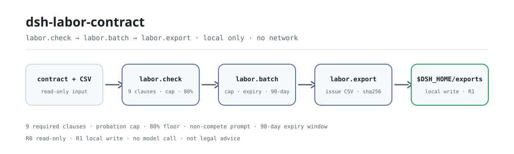

<div align="center">

<picture>
  <source media="(prefers-color-scheme: dark)" srcset="docs/assets/dsh-labor-contract-flow-dark.svg">
  
</picture>

# dsh-labor-contract

**Convierte un texto de contrato laboral y un CSV de empleados en una lista de incidencias revisable: cláusulas obligatorias ausentes, periodo de prueba por encima del límite, salario de prueba por debajo del 80% y contratos vencidos o próximos a vencer; después exporta la lista como CSV.**

Un plugin de revisión de contratos puramente local para RR. HH. y operaciones legales: nueve cláusulas obligatorias, límite del periodo de prueba, suelo del 80% del salario de prueba, vencimiento por lotes y aviso de compensación por no competencia, con exportación CSV firmada con sha256 — sin red, sin llamadas a modelos y sin asesoramiento jurídico.

[Instalar](#instalación-en-tres-pasos) · [Configuración](#configuración) · [FAQ](#faq) · [简体中文](README.md) · [English](README.en.md) · [Español](README.es.md) · [Português](README.pt.md) · [हिन्दी](README.hi.md)

[](LICENSE)
[](#compatibilidad)
[](https://www.npmjs.com/package/dsh-labor-contract)
[](https://github.com/PerryLink/dsh-labor-contract/actions/workflows/ci.yml)
[](#compatibilidad)

[](https://github.com/PerryLink/dsh-labor-contract/stargazers)
[](https://www.npmjs.com/package/dsh-labor-contract)
[](https://dshfind.com/plugins/PerryLink/dsh-labor-contract?ref=badge)
[](https://gitee.com/perrylink/dsh-labor-contract)

```sh
dsh plugin --profile <profile> add dsh-labor-contract
```

</div>

<sub>Plugin de la comunidad, no afiliado a DeepSeek. Repositorio canónico: <https://github.com/PerryLink/dsh-labor-contract> (Gitee es un espejo). Estado: alpha / sintético-público / parcial / not counted / no GA — sin contratos de clientes ni datos de empleados reales, y sin declaraciones de producción o cumplimiento legal.</sub>

## Qué es

`dsh-labor-contract` lee un contrato laboral en texto plano, comprueba la cobertura de las nueve cláusulas obligatorias, calcula el límite del periodo de prueba según la duración del contrato, compara el salario de prueba con el suelo del 80% y avisa sobre la compensación y el plazo de dos años en las cláusulas de no competencia. También revisa por lotes un CSV de contratos de empleados: periodo de prueba por encima del límite, contratos vencidos o que vencen en 90 días y salario de prueba por debajo del 80%. Por último escribe la lista de incidencias como CSV con un recibo `sha256`.

Solo comprueba **cobertura de cláusulas, fechas y proporciones**: todo se ejecuta en tu máquina, los archivos de origen son de solo lectura y no hay red ni llamadas a modelos.

- **Sirve para:** una autocomprobación estructurada antes de firmar por parte de RR. HH. o legal ops; revisiones por lotes de 6–500 empleados; entregar una lista de incidencias estructurada a un revisor; alimentar un registro de contratos.
- **No sirve para:** sustituir a un abogado; decidir validez, penalizaciones, equity, confidencialidad o titularidad de la propiedad intelectual; leer PDF, escaneos o DOCX directamente (solo texto); comprobar el salario mínimo local, la base de la seguridad social o los impuestos sobre la nómina.

## Instalación en tres pasos

1. **Instala** (elige un canal):

   ```sh
   # canal npm (recomendado, versiones publicadas)
   dsh plugin --profile <profile> add dsh-labor-contract
   # canal git (main más reciente; equivale a git+https://github.com/PerryLink/dsh-labor-contract.git)
   dsh plugin --profile <profile> add github:PerryLink/dsh-labor-contract
   # canal tarball: pnpm pack en este repo y después
   dsh plugin --profile <profile> add ./dsh-labor-contract-<version>.tgz
   ```

   No hay paso de compilación; el `lib/` instalado es el artefacto publicado.

2. **Verifica que está activo**:

   ```sh
   dsh --profile <profile> --dump-config | grep dsh-labor-contract
   ```

3. **Ejecuta el ejemplo incluido** (ejecuta `pnpm build` en este repo primero; un contrato sintético de 36 meses + seis empleados sintéticos, comparado con el archivo dorado):

   ```sh
   node samples/quickstart/run.mjs --check
   ```

**Desinstalar:** `dsh plugin --profile <profile> remove dsh-labor-contract` (o borra la línea del patch del perfil).

## Capacidades clave

Los nombres de las herramientas son API estable; las descripciones se mantienen en inglés para coincidir con la salida en tiempo de ejecución.

| Herramienta | Propósito | Riesgo |
|---|---|---|
| `labor.check` | Un contrato: nueve cláusulas obligatorias + límite del periodo de prueba + salario de prueba al 80% + aviso de compensación por no competencia | R0 (solo lectura) |
| `labor.batch` | Lote CSV: periodo de prueba por encima del límite, contratos vencidos / que vencen en 90 días, salario de prueba por debajo del 80% | R0 (solo lectura) |
| `labor.export` | Escribe la lista de incidencias como CSV entrecomillado; devuelve ruta y sha256 | R1 (escritura local solo en exports) |

- **Nueve cláusulas obligatorias:** duración, funciones, lugar, jornada/descanso, salario, seguridad social, protección laboral, extinción y resolución de conflictos, cada una con frase de evidencia y `present` / `attention` / `missing`.
- **Límite del periodo de prueba:** 0 / 1 / 2 / 6 meses según meses enteros de contrato (con fecha de fin incluida); devuelve `unknown` en vez de adivinar si no puede interpretar la duración.
- **Salario de prueba al 80%:** se compara en céntimos; exactamente 80% pasa, solo por debajo es `below_80`.
- **Vencimiento por lotes:** códigos `CONTRACT_EXPIRED` y `CONTRACT_EXPIRING` con una ventana de aviso de 90 días por defecto.
- **Aviso de no competencia:** comprueba si se menciona compensación mensual y si el plazo supera dos años; no juzga si es exigible.
- **Entregable revisable:** el CSV exportado incluye `sha256` y se escribe en `$DSH_HOME/dsh-labor-contract/exports/`.

## Ejemplo

Pega esta línea en el agente:

```text
帮我核对这份劳动合同的必备条款、试用期上限和试用期工资比例，再把 6 名员工的合同批量查一遍到期和试用期问题。
```

O llama directamente a la superficie de herramientas:

```sh
# 1) revisar un contrato
#    superficie: labor.check({ text: "<cuerpo del contrato>" })

# 2) revisión por lotes
#    superficie: labor.batch({ csv: "<texto CSV>", as_of: "2026-11-02" })

# 3) exportar la lista de incidencias
#    superficie: labor.export({ issues: [...batch.issues], filename: "labor-issues.csv" })
```

Reproduce el ejemplo incluido y compáralo con el archivo dorado:

```sh
node samples/quickstart/run.mjs --check
```


El ejemplo es un contrato sintético de 36 meses más seis empleados sintéticos: las nueve cláusulas aparecen; periodo de prueba de 3 meses (límite 6 meses); salario de prueba 10800 / 12000 = 90%; no competencia de dos años con compensación mensual. El lote devuelve cuatro incidencias: un periodo de prueba por encima del límite, un contrato vencido, un salario de prueba del 79,99% y un contrato que vence en 74 días. `samples/quickstart/expected/result.json` es la salida real de `node samples/quickstart/run.mjs --json`, no escrita a mano; la captura es la salida real de terminal de `--check` (captura cruda en [`docs/assets/quickstart.log`](docs/assets/quickstart.log)).

## Entrada

- `labor.check`: un contrato laboral en **texto plano** (`.txt` o cuerpo pegado). Convierte antes PDF, escaneos o DOCX con una herramienta de confianza; este paquete no hace OCR ni analiza documentos binarios.
- `labor.batch`: un CSV UTF-8 con la cabecera fija
  `employee,position,contract_start,contract_end,probation_months,monthly_salary,probation_salary`.
  - `probation_salary` es opcional; sin ella se omite la comprobación del 80%.
  - Las fechas son `YYYY-MM-DD`; `contract_end` también acepta la palabra clave china para contrato indefinido.
  - Los importes usan `1234.56`; sin `¥`, espacios ni unidades chinas.
- `labor.export`: un arreglo de incidencias (normalmente `issues` de `labor.batch`) y un nombre de archivo seguro.
- Todas las entradas son de solo lectura.

Valores aceptados de `contract_end`:

```text
2026-12-31
无固定期限
```

| Columna | Obligatoria | Notas |
|---|---|---|
| `employee` | sí | Nombre o número de empleado |
| `position` | sí | Puesto |
| `contract_start` | sí | `YYYY-MM-DD` |
| `contract_end` | sí | `YYYY-MM-DD` o la palabra clave de contrato indefinido |
| `probation_months` | sí | Entero no negativo, meses |
| `monthly_salary` | sí | Salario mensual pactado en CNY, máximo 2 decimales |
| `probation_salary` | no | Salario mensual de prueba; omítelo para saltar la comprobación del 80% |

```csv
employee,position,contract_start,contract_end,probation_months,monthly_salary,probation_salary
陈一（合成）,前端工程师,2026-01-01,2028-12-31,3,12000,10800
```

## Salida

- `labor.check`: `clauses` (9 elementos, cada uno `present` / `attention` / `missing` con frase de evidencia y una pista), `summary`, `term`, `probation`, `probation_pay`, `non_compete` y `disclaimer_zh`.
- `labor.batch`: `as_of`, `rows`, `issues`, `due.expired` / `due.expiring`, `summary.by_code`.
- `labor.export`: ruta del CSV, número de filas, bytes y `sha256`, escrito en `$DSH_HOME/dsh-labor-contract/exports/`.
- Las fechas son `YYYY-MM-DD`; el dinero se compara en céntimos enteros para evitar derivas de coma flotante.

## Reglas de decisión

### Nueve cláusulas obligatorias

Duración, funciones, lugar, jornada/descanso, salario, seguridad social, protección laboral, extinción y resolución de conflictos.

Cada elemento es uno de:

- `present`: la cláusula y sus detalles son visibles (fechas, puesto, ciudad, importe, tipos de seguro, preaviso/compensación, vía de arbitraje).
- `attention`: existe la palabra clave pero faltan detalles (por ejemplo, un título «Duración del contrato» sin fechas).
- `missing`: no aparece ninguna palabra clave de esa cláusula.

Es una heurística de palabras clave y patrones, **no** interpretación contractual. Una cláusula puede parecer completa y seguir siendo inválida; otro estilo de redacción también puede clasificarse mal. Se requiere revisión humana.

### Límite del periodo de prueba

Según los meses enteros del contrato (con fecha de fin incluida):

| Duración del contrato | Límite del periodo de prueba |
|---|---|
| Menos de 3 meses | Sin periodo de prueba |
| De 3 meses a menos de 1 año | 1 mes |
| De 1 año a menos de 3 años | 2 meses |
| 3 años o más / indefinido | 6 meses |
| Por obra o tarea determinada | Sin periodo de prueba |

Los límites usan meses enteros inclusivos: 2026-01-01 a 2026-03-31 son 3 meses; a 2026-03-30 son 2 meses enteros. Si no se puede interpretar la duración, el resultado es `unknown`, nunca una suposición.

### Salario de prueba al 80%

`labor.check` extrae el salario de prueba y el salario mensual pactado y compara en céntimos: por debajo del 80% solo si `prueba × 100 < pactado × 80`; exactamente 80% pasa. `labor.batch` aplica la misma regla por fila. **El salario mínimo local es una comprobación aparte que este paquete no puede conocer** — verifícalo para tu ciudad.

### Aviso de no competencia

Cuando detecta una cláusula de no competencia, comprueba si se menciona compensación mensual y si el plazo supera dos años; cualquiera de los dos fallos es `attention`. No juzga si la cláusula es exigible.

### Vencimiento por lotes

Con `as_of` (por defecto hoy):

- `contract_end < as_of`: `CONTRACT_EXPIRED`, en `due.expired`.
- `0 ≤ contract_end - as_of ≤ 90`: `CONTRACT_EXPIRING`, en `due.expiring`.
- `contract_end` es la palabra clave de contrato indefinido: sin comprobación de vencimiento; el límite del periodo de prueba es 6 meses.

La ventana de 90 días es el valor de recordatorio por defecto del paquete, no un plazo legal de preaviso. Cambia `EXPIRING_WINDOW_DAYS` en `src/core/labor.ts` y recompila para ajustarla.

## Configuración

Este plugin no tiene claves de configuración a nivel de perfil (`cordis.patch.yml` solo inserta el propio plugin); todo lo ajustable es un parámetro de herramienta por llamada:

```yaml
- insert:
    - id: dsh-labor-contract
      name: 'dsh-labor-contract'
```

| Parámetro | Valor por defecto | Significado |
|---|---|---|
| `text` | (obligatorio, `labor.check`) | Texto plano del contrato laboral; solo lectura, sin OCR |
| `csv` | (obligatorio, `labor.batch`) | Texto CSV de contratos de empleados, cabecera fija, separado por comas |
| `as_of` | hoy | Fecha de referencia de vencimiento de `labor.batch`, `YYYY-MM-DD` |
| `issues` | (obligatorio, `labor.export`) | Arreglo de incidencias, normalmente `issues` de `labor.batch` |
| `filename` | derivado de la fecha | Nombre de archivo de `labor.export`, solo `[A-Za-z0-9._-]`; siempre en `$DSH_HOME/dsh-labor-contract/exports/` |

## FAQ

<details>
<summary>¿Esto es asesoramiento jurídico?</summary>

No. Solo comprueba cobertura de cláusulas, fechas y proporciones y devuelve un `disclaimer_zh` explícito. Consulta a un abogado cualificado o a la autoridad laboral de tu zona para decisiones de cumplimiento.

</details>

<details>
<summary>¿Puede leer PDF / DOCX / escaneos?</summary>

No. Solo acepta texto plano. Convierte antes el contrato con una herramienta de confianza; los escaneos necesitan además OCR. Este paquete nunca llama a la red ni a un servicio de OCR.

</details>

<details>
<summary>¿Los meses de prueba son naturales o días?</summary>

Meses enteros con la fecha de fin incluida. `contractTermMonths` suma un día al final, calcula la diferencia de meses y corrige por días: 2026-01-01..2026-03-31 = 3 meses. El valor de prueba acepta meses/días/años; los días se convierten a 30 días por mes, así que 45 días se comparan como 1,5 meses.

</details>

<details>
<summary>¿El suelo del 80% es antes o después de impuestos?</summary>

Compara los dos importes escritos en el contrato, sin impuestos, seguridad social ni deducciones de vivienda. Usa la misma base para `monthly_salary` y `probation_salary`.

</details>

<details>
<summary>¿Por qué una ventana de vencimiento de 90 días?</summary>

Es el recordatorio de renovación por defecto del paquete, no un valor legal. Cambia `EXPIRING_WINDOW_DAYS` en `src/core/labor.ts`, recompila y vuelve a generar el archivo dorado y la captura.

</details>

<details>
<summary>¿Sube contratos o llama a un modelo?</summary>

No. Las tres herramientas son código local: sin red, sin subida, sin llamadas a modelos. `labor.export` solo escribe en `$DSH_HOME/dsh-labor-contract/exports/`.

</details>

## Permisos y datos

- **Lectura:** el texto del contrato y el CSV de empleados que indique el usuario (ejemplo: `samples/quickstart/input/`); nada más.
- **Escritura:** solo `$DSH_HOME/dsh-labor-contract/exports/` (`labor.export`); los archivos de origen no se tocan.
- **Red:** no.
- **Sistemas externos:** ninguno.

`labor.check` y `labor.batch` son **R0** (solo lectura). `labor.export` es **R1** (escritura local en `$DSH_HOME/dsh-labor-contract`). `DSH_LABOR_CONTRACT_HOME` puede sobrescribir la raíz de escritura local para pruebas; el valor por defecto es exactamente `$DSH_HOME/dsh-labor-contract`.

## Limitaciones conocidas

- **No es asesoramiento jurídico:** sin determinaciones de validez, indemnización, penalización o exigibilidad.
- **Solo texto:** sin PDF/DOCX/OCR ni análisis de binarios.
- **Heurística de palabras clave:** sinónimos, tablas y cláusulas fusionadas pueden clasificar mal `present` / `attention` / `missing`; se requiere revisión humana.
- **Límite de prueba solo por duración:** no modela la regla de «un solo periodo de prueba por empresa y empleado», el trabajo de agencia ni el tiempo parcial.
- **El 80% compara dos importes del contrato:** el salario mínimo local, la base de seguridad social, los impuestos y la base antes/después de impuestos quedan fuera de alcance.
- **La no competencia es solo un aviso:** sin prueba de razonabilidad de alcance, geografía o puesto.
- **La ventana de 90 días es local:** no es un plazo legal de preaviso.
- **El CSV solo usa comillas RFC 4180:** sin saneado de prefijos de fórmula de Excel; no abras CSV de origen desconocido directamente en Excel.
- **Solo muestras públicas/sintéticas:** alpha/parcial, not counted, sin declaración de GA ni de producción.

## Evidencia de aceptación

Los accesorios públicos/sintéticos viven en `samples/quickstart/`; `ACCEPTANCE.csv` registra nueve comprobaciones públicas más una fila dorada de quickstart. Todas las filas son `counted=false` excepto la de quickstart.

| req_id | metric | threshold | actual | pass | source | counted |
|---|---|---|---|---|---|---|
| LABOR-A01 | nine required clauses present | 9/9 | 9/9 | true | public/synthetic | false |
| LABOR-A02 | missing clauses detected | 9 | 9 | true | public/synthetic | false |
| LABOR-A03 | probation cap boundary | ok/over/over | ok/over_limit/over_limit | true | public/synthetic | false |
| LABOR-A04 | 80% probation-pay boundary | ok/below_80 | ok/below_80 | true | public/synthetic | false |
| LABOR-A05 | 6-person batch issues | 4 | 6rows/4issues | true | public/synthetic | false |
| LABOR-A06 | expiry window | 1expired/1expiring | 1expired/1expiring | true | public/synthetic | false |
| LABOR-A07 | invalid date error | E_LABOR_DATE_INVALID | E_LABOR_DATE_INVALID | true | public/synthetic | false |
| LABOR-A08 | export path safety | E_LABOR_PATH_INVALID | E_LABOR_PATH_INVALID | true | public/synthetic | false |
| LABOR-A09 | export sha256/bytes | matches file | ok | true | public/synthetic | false |
| PS1-QS01 | quickstart golden | 1/1 | 1 | true | synthetic/quickstart | true |

*Filas respaldadas por accesorios, no una ejecución de cliente; ninguna salida está inventada.* Consulta [EVIDENCE.md](EVIDENCE.md) para el entorno y los resultados por comando; las ejecuciones anteriores viven en `evidence/`.

## Compatibilidad

| Superficie | Estado |
|---|---|
| Harness | `dsh >=0.2.1-rc.3 <0.4.0` |
| Node | `>=24.9.0 <25` |
| Plataformas | Todas; solo archivos locales |
| Datos | Sin red, sin llamadas a modelos, sin subida |

## Ecosistema y calidad

- [Espejo de Gitee](https://gitee.com/perrylink/dsh-labor-contract) (espejo sincronizado; GitHub es el canónico)
- [Página del plugin en dshfind](https://dshfind.com/plugins/PerryLink/dsh-labor-contract) (instalaciones y clasificación)
- [Índice de dominio](https://perrylink.github.io/dsh-plugins/) (el catálogo de plugins de PerryLink)
- Plugins relacionados de la familia: [dsh-legal-intake](https://github.com/PerryLink/dsh-legal-intake) (recepción y libro de solicitudes legales), [dsh-contract-renewal](https://github.com/PerryLink/dsh-contract-renewal) (vencimiento / ventana de renovación), [dsh-pim-lint](https://github.com/PerryLink/dsh-pim-lint) (herramientas de validación CSV)

## Desarrollo

```sh
pnpm install --frozen-lockfile
pnpm build && pnpm lint && pnpm typecheck
node --test test/*.test.mjs
node scripts/gate.mjs
```

Versión actual `0.1.0` · 31 pruebas superadas (`node --test test/*.test.mjs`). Las imágenes del README se generan programáticamente con [`scripts/gen-readme-assets.py`](scripts/gen-readme-assets.py) (Python; el diagrama de flujo hero es un SVG escrito a mano en variantes clara y oscura) y puede reejecutarse en cualquier momento.

Topics: `deepseek-harness`, `dsh`, `dsh-plugin`, `labor`, `contract`, `hr`, `probation`, `compliance`, `perrylink`

## Familia y agradecimientos

Este proyecto es miembro de la familia de plugins de DeepSeek Harness mantenida por [PerryLink](https://github.com/PerryLink) (todos Apache-2.0). Si este plugin te ayuda, **una estrella facilita que la siguiente persona lo encuentre** — nada está bloqueado tras ella.

- [@PerryLink](https://github.com/PerryLink) — creador y mantenedor: cobertura de cláusulas, límite del periodo de prueba y comprobaciones del 80%, la canalización de vencimiento por lotes, el ejemplo dorado de quickstart con su evidencia de aceptación y la documentación en cinco idiomas.

## Licencia

[LICENSE](LICENSE) (Apache License 2.0) © 2026 dsh-labor-contract contributors. Consulta también `NOTICE` y `THIRD-PARTY-NOTICES`.

<p align="center"><sub>Apache-2.0 · Plugin de la comunidad, no afiliado a DeepSeek.</sub></p>
