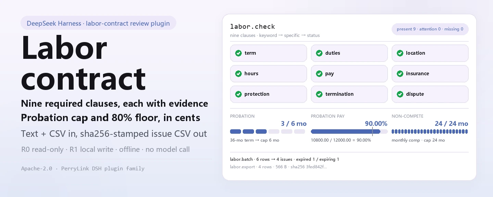

<div align="center">

<picture>
  <source media="(prefers-color-scheme: dark)" srcset="docs/assets/dsh-labor-contract-hero-en-dark.webp">
  
</picture>

# dsh-labor-contract

**एक श्रम अनुबंध के टेक्स्ट और एक कर्मचारी CSV को समीक्षा-योग्य समस्या सूची में बदलें: गायब अनिवार्य क्लॉज़, सीमा से अधिक परिवीक्षा अवधि, 80% से कम परिवीक्षा वेतन, और समाप्त या जल्द समाप्त होने वाले अनुबंध; फिर सूची को CSV में एक्सपोर्ट करें।**

HR और कानूनी संचालन के लिए पूरी तरह लोकल अनुबंध समीक्षा प्लगइन: नौ अनिवार्य क्लॉज़, परिवीक्षा अवधि की सीमा, परिवीक्षा वेतन का 80% फ़्लोर, बैच में समाप्ति और गैर-प्रतिस्पर्धा मुआवज़े का संकेत, तथा sha256 वाला CSV एक्सपोर्ट — बिना नेटवर्क, बिना मॉडल कॉल, कानूनी सलाह नहीं।

[इंस्टॉल](#तीन-चरणों-में-शुरुआत) · [कॉन्फ़िगरेशन](#कॉन्फ़िगरेशन) · [FAQ](#faq) · [简体中文](README.md) · [English](README.en.md) · [Español](README.es.md) · [Português](README.pt.md) · [हिन्दी](README.hi.md)

[](LICENSE)
[](#संगतता)
[](https://www.npmjs.com/package/dsh-labor-contract)
[](https://github.com/PerryLink/dsh-labor-contract/actions/workflows/ci.yml)
[](#संगतता)

[](https://github.com/PerryLink/dsh-labor-contract/stargazers)
[](https://www.npmjs.com/package/dsh-labor-contract)
[](https://dshfind.com/plugins/PerryLink/dsh-labor-contract?ref=badge)
[](https://gitee.com/perrylink/dsh-labor-contract)

```sh
dsh plugin --profile <profile> add dsh-labor-contract
```

</div>

<sub>सामुदायिक प्लगइन, DeepSeek से असंबद्ध। कैनोनिकल रिपॉज़िटरी: <https://github.com/PerryLink/dsh-labor-contract> (Gitee एक मिरर है)। स्थिति: alpha / सार्वजनिक-सिंथेटिक / आंशिक / not counted / GA नहीं — कोई ग्राहक अनुबंध या वास्तविक कर्मचारी डेटा नहीं, और उत्पादन-तैयारी या कानूनी-अनुपालन का दावा नहीं।</sub>

## यह क्या है

`dsh-labor-contract` एक श्रम अनुबंध को सादे टेक्स्ट के रूप में पढ़ता है, नौ अनिवार्य क्लॉज़ की कवरेज जाँचता है, अनुबंध की अवधि से परिवीक्षा अवधि की सीमा निकालता है, परिवीक्षा वेतन की तुलना 80% फ़्लोर से करता है, और गैर-प्रतिस्पर्धा खंड मिलने पर मासिक मुआवज़े तथा दो वर्ष की सीमा का संकेत देता है। यह कर्मचारी अनुबंध CSV को बैच में भी जाँचता है: सीमा से अधिक परिवीक्षा, समाप्त या 90 दिनों में समाप्त होने वाले अनुबंध, और 80% से कम परिवीक्षा वेतन। अंत में समस्या सूची को `sha256` रसीद वाली CSV में लिखता है।

यह केवल **क्लॉज़ कवरेज, तारीख़ें और अनुपात** जाँचता है: सब कुछ आपकी मशीन पर चलता है, स्रोत फ़ाइलें केवल-पठनीय रहती हैं, और कोई नेटवर्क या मॉडल कॉल नहीं होता।

- **उपयुक्त:** HR या कानूनी संचालन द्वारा हस्ताक्षर से पहले संरचित स्व-जाँच; 6–500 कर्मचारियों की बैच समीक्षा; समीक्षक को संरचित समस्या सूची देना; अनुबंध रजिस्टर के इनपुट के रूप में उपयोग।
- **अनुपयुक्त:** वकील की जगह लेना; वैधता, जुर्माना, इक्विटी, गोपनीयता या बौद्धिक संपदा स्वामित्व तय करना; PDF, स्कैन या DOCX सीधे पढ़ना (केवल टेक्स्ट); स्थानीय न्यूनतम वेतन, सामाजिक-सुरक्षा आधार या पेरोल कर की जाँच।

<picture>
  <source media="(prefers-color-scheme: dark)" srcset="docs/assets/dsh-labor-contract-flow-v5-dark.svg">
  
</picture>

## तीन चरणों में शुरुआत

1. **इंस्टॉल करें** (कोई एक चैनल चुनें):

   ```sh
   # npm चैनल (अनुशंसित, प्रकाशित संस्करण)
   dsh plugin --profile <profile> add dsh-labor-contract
   # git चैनल (नवीनतम main; git+https://github.com/PerryLink/dsh-labor-contract.git के बराबर)
   dsh plugin --profile <profile> add github:PerryLink/dsh-labor-contract
   # tarball चैनल: इस रेपो में pnpm pack करके
   dsh plugin --profile <profile> add ./dsh-labor-contract-<version>.tgz
   ```

   कोई बिल्ड चरण नहीं है; इंस्टॉल किया गया `lib/` ही प्रकाशित आर्टिफ़ैक्ट है।

2. **सक्रिय होने की पुष्टि करें**:

   ```sh
   dsh --profile <profile> --dump-config | grep dsh-labor-contract
   ```

3. **साथ दिया नमूना चलाएँ** (पहले इस रेपो में `pnpm build` चलाएँ; एक सिंथेटिक 36-महीने का अनुबंध + छह सिंथेटिक कर्मचारी, गोल्डन फ़ाइल से तुलना):

   ```sh
   node samples/quickstart/run.mjs --check
   ```

**अनइंस्टॉल:** `dsh plugin --profile <profile> remove dsh-labor-contract` (या प्रोफ़ाइल पैच से पंक्ति हटाएँ)।

## मुख्य क्षमताएँ

टूल के नाम स्थिर API हैं; विवरण रनटाइम आउटपुट से मेल खाने के लिए अंग्रेज़ी में रखे गए हैं।

| टूल | उद्देश्य | जोखिम |
|---|---|---|
| `labor_check` | एक अनुबंध: नौ अनिवार्य क्लॉज़ + परिवीक्षा सीमा + परिवीक्षा वेतन 80% + गैर-प्रतिस्पर्धा मुआवज़ा संकेत | R0 (केवल-पठनीय) |
| `labor_batch` | CSV बैच: सीमा से अधिक परिवीक्षा, समाप्त / 90 दिनों में समाप्त होने वाले अनुबंध, 80% से कम परिवीक्षा वेतन | R0 (केवल-पठनीय) |
| `labor_export` | समस्या सूची को उद्धरण-सहित CSV में लिखें; पथ और sha256 लौटाएँ | R1 (केवल exports में लोकल लेखन) |

- **नौ अनिवार्य क्लॉज़:** अवधि, कर्तव्य, स्थान, कार्यसमय/विश्राम, वेतन, सामाजिक बीमा, श्रम सुरक्षा, समाप्ति और विवाद समाधान — प्रत्येक साक्ष्य वाक्य तथा `present` / `attention` / `missing` के साथ।
- **परिवीक्षा सीमा:** अनुबंध के पूर्ण महीनों (अंतिम तिथि सहित) के अनुसार 0 / 1 / 2 / 6 महीने; अवधि समझ न आने पर अनुमान के बजाय `unknown` लौटाता है।
- **परिवीक्षा वेतन 80%:** पैसे की तुलना में; ठीक 80% पास होता है, केवल कम होने पर `below_80`।
- **बैच समाप्ति:** डिफ़ॉल्ट 90-दिन की चेतावनी विंडो के साथ `CONTRACT_EXPIRED` और `CONTRACT_EXPIRING` कोड।
- **गैर-प्रतिस्पर्धा संकेत:** मासिक मुआवज़े का उल्लेख और दो वर्ष से अधिक अवधि जाँचता है; लागू होने की वैधता नहीं तय करता।
- **समीक्षा-योग्य डिलीवरेबल:** एक्सपोर्ट की गई CSV में `sha256` होता है और वह `$DSH_HOME/dsh-labor-contract/exports/` में लिखी जाती है।

## उदाहरण

यह पंक्ति एजेंट को भेजें:

```text
帮我核对这份劳动合同的必备条款、试用期上限和试用期工资比例，再把 6 名员工的合同批量查一遍到期和试用期问题。
```

या सीधे टूल सतह का उपयोग करें:

```sh
# 1) एक अनुबंध की समीक्षा
#    टूल सतह: labor_check({ text: "<अनुबंध का मुख्य भाग>" })

# 2) बैच जाँच
#    टूल सतह: labor_batch({ csv: "<CSV टेक्स्ट>", as_of: "2026-11-02" })

# 3) समस्या सूची एक्सपोर्ट करें
#    टूल सतह: labor_export({ issues: [...batch.issues], filename: "labor-issues.csv" })
```

साथ दिया नमूना दोबारा चलाएँ और गोल्डन फ़ाइल से तुलना करें:

```sh
node samples/quickstart/run.mjs --check
```


नमूना एक सिंथेटिक 36-महीने का अनुबंध और छह सिंथेटिक कर्मचारी हैं: नौ क्लॉज़ सभी मिले; परिवीक्षा 3 महीने (सीमा 6 महीने); परिवीक्षा वेतन 10800 / 12000 = 90%; दो वर्ष की गैर-प्रतिस्पर्धा और मासिक मुआवज़ा। बैच चार समस्याएँ देता है: एक सीमा से अधिक परिवीक्षा, एक समाप्त अनुबंध, एक 79.99% परिवीक्षा वेतन, और एक अनुबंध जो 74 दिनों में समाप्त होगा। `samples/quickstart/expected/result.json` `node samples/quickstart/run.mjs --json` का वास्तविक आउटपुट है, हाथ से लिखा नहीं; स्क्रीनशॉट `--check` के वास्तविक टर्मिनल आउटपुट से है (कच्चा कैप्चर [`docs/assets/quickstart.log`](docs/assets/quickstart.log) में)।

## इनपुट

- `labor_check`: एक श्रम अनुबंध **सादे टेक्स्ट** में (`.txt` या चिपकाया हुआ मुख्य भाग)। PDF, स्कैन या DOCX को पहले किसी भरोसेमंद टूल से टेक्स्ट में बदलें; यह पैकेज OCR नहीं करता और बाइनरी दस्तावेज़ नहीं पढ़ता।
- `labor_batch`: एक UTF-8 CSV जिसका हेडर निश्चित है
  `employee,position,contract_start,contract_end,probation_months,monthly_salary,probation_salary`।
  - `probation_salary` वैकल्पिक है; इसके बिना 80% जाँच छूट जाती है।
  - तारीख़ें `YYYY-MM-DD` हैं; `contract_end` में अनिश्चितकालीन अनुबंध के लिए चीनी कीवर्ड भी स्वीकार है।
  - राशि `1234.56` की तरह; `¥`, स्पेस या चीनी इकाइयाँ नहीं।
- `labor_export`: समस्याओं की सरणी (सामान्यतः `labor_batch` का `issues`) और एक सुरक्षित फ़ाइल नाम।
- सभी इनपुट केवल-पठनीय हैं।

`contract_end` के स्वीकार्य मान:

```text
2026-12-31
无固定期限
```

| कॉलम | आवश्यक | टिप्पणी |
|---|---|---|
| `employee` | हाँ | नाम या कर्मचारी आईडी |
| `position` | हाँ | पद |
| `contract_start` | हाँ | `YYYY-MM-DD` |
| `contract_end` | हाँ | `YYYY-MM-DD` या अनिश्चितकालीन कीवर्ड |
| `probation_months` | हाँ | गैर-ऋणात्मक पूर्णांक, महीने |
| `monthly_salary` | हाँ | CNY में तय मासिक वेतन, अधिकतम 2 दशमलव |
| `probation_salary` | नहीं | परिवीक्षा मासिक वेतन; 80% जाँच छोड़ने के लिए हटा दें |

```csv
employee,position,contract_start,contract_end,probation_months,monthly_salary,probation_salary
陈一（合成）,前端工程师,2026-01-01,2028-12-31,3,12000,10800
```

## आउटपुट

- `labor_check`: `clauses` (9 आइटम, प्रत्येक `present` / `attention` / `missing` + साक्ष्य वाक्य + संकेत), `summary`, `term`, `probation`, `probation_pay`, `non_compete` और `disclaimer_zh`।
- `labor_batch`: `as_of`, `rows`, `issues`, `due.expired` / `due.expiring`, `summary.by_code`।
- `labor_export`: CSV पथ, पंक्ति संख्या, बाइट्स और `sha256`, `$DSH_HOME/dsh-labor-contract/exports/` में लिखा गया।
- सभी तारीख़ें `YYYY-MM-DD`; फ़्लोटिंग-पॉइंट त्रुटि से बचने के लिए पैसा पूर्ण पैसों में तुलना किया जाता है।

## निर्णय नियम

### नौ अनिवार्य क्लॉज़

अवधि, कर्तव्य, स्थान, कार्यसमय/विश्राम, वेतन, सामाजिक बीमा, श्रम सुरक्षा, समाप्ति और विवाद समाधान।

प्रत्येक आइटम इनमें से एक है:

- `present`: क्लॉज़ और उसका विवरण दिखाई देता है (तारीख़ें, पद, शहर, राशि, बीमा प्रकार, नोटिस/मुआवज़ा, मध्यस्थता मार्ग)।
- `attention`: कीवर्ड मौजूद है पर विवरण गायब है (जैसे «अनुबंध अवधि» शीर्षक बिना तारीख़ों के)।
- `missing`: उस क्लॉज़ का कोई कीवर्ड नहीं मिला।

यह कीवर्ड/पैटर्न अनुमान है, **अनुबंध की व्याख्या नहीं**। कोई क्लॉज़ पूरा दिख सकता है और फिर भी अवैध हो सकता है; दूसरी लेखन शैली को गलत वर्गीकृत भी किया जा सकता है। मानवीय समीक्षा आवश्यक है।

### परिवीक्षा सीमा

अनुबंध के पूर्ण महीनों के आधार पर (अंतिम तिथि सहित):

| अनुबंध अवधि | परिवीक्षा सीमा |
|---|---|
| 3 महीने से कम | कोई परिवीक्षा नहीं |
| 3 महीने से 1 वर्ष से कम | 1 महीना |
| 1 वर्ष से 3 वर्ष से कम | 2 महीने |
| 3 वर्ष या अधिक / अनिश्चितकालीन | 6 महीने |
| किसी कार्य/लक्ष्य की पूर्ति तक | कोई परिवीक्षा नहीं |

सीमाएँ समावेशी पूर्ण महीनों पर: 2026-01-01 से 2026-03-31 = 3 महीने; 2026-03-30 तक = 2 पूर्ण महीने। अवधि समझ न आने पर परिणाम `unknown` होता है, कभी अनुमान नहीं।

### परिवीक्षा वेतन 80%

`labor_check` परिवीक्षा वेतन और तय मासिक वेतन निकालकर पैसों में तुलना करता है: 80% से कम केवल तब जब `परिवीक्षा × 100 < तय × 80`; ठीक 80% पास होता है। `labor_batch` हर पंक्ति पर वही नियम लगाता है। **स्थानीय न्यूनतम वेतन एक अलग जाँच है जो यह पैकेज नहीं जान सकता** — अपने शहर के लिए उसे अलग से जाँचें।

### गैर-प्रतिस्पर्धा संकेत

गैर-प्रतिस्पर्धा खंड मिलने पर यह देखता है कि मासिक मुआवज़े का उल्लेख है या नहीं और अवधि दो वर्ष से अधिक है या नहीं; इनमें से कोई भी कमी `attention` है। यह नहीं तय करता कि खंड लागू करने योग्य है या नहीं।

### बैच समाप्ति

`as_of` (डिफ़ॉल्ट आज) के साथ:

- `contract_end < as_of`: `CONTRACT_EXPIRED`, `due.expired` में।
- `0 ≤ contract_end - as_of ≤ 90`: `CONTRACT_EXPIRING`, `due.expiring` में।
- `contract_end` अनिश्चितकालीन कीवर्ड है: कोई समाप्ति जाँच नहीं; परिवीक्षा सीमा 6 महीने।

90-दिन की विंडो इस पैकेज का डिफ़ॉल्ट नवीनीकरण संकेत है, कोई कानूनी नोटिस अवधि नहीं। इसे बदलने के लिए `src/core/labor.ts` में `EXPIRING_WINDOW_DAYS` बदलें और फिर से बिल्ड करें।

## कॉन्फ़िगरेशन

इस प्लगइन में प्रोफ़ाइल-स्तरीय कॉन्फ़िग कुंजियाँ नहीं हैं (`cordis.patch.yml` केवल प्लगइन को सम्मिलित करता है); हर समायोजन प्रति-कॉल टूल पैरामीटर है:

```yaml
- insert:
    - id: dsh-labor-contract
      name: 'dsh-labor-contract'
```

| पैरामीटर | डिफ़ॉल्ट | अर्थ |
|---|---|---|
| `text` | (आवश्यक, `labor_check`) | श्रम अनुबंध का सादा टेक्स्ट; केवल-पठनीय, OCR नहीं |
| `csv` | (आवश्यक, `labor_batch`) | कर्मचारी अनुबंध CSV टेक्स्ट, निश्चित हेडर, कॉमा से अलग |
| `as_of` | आज | `labor_batch` की समाप्ति संदर्भ तिथि, `YYYY-MM-DD` |
| `issues` | (आवश्यक, `labor_export`) | समस्याओं की सरणी, सामान्यतः `labor_batch` का `issues` |
| `filename` | तिथि से व्युत्पन्न | `labor_export` फ़ाइल नाम, केवल `[A-Za-z0-9._-]`; सदैव `$DSH_HOME/dsh-labor-contract/exports/` में |

## FAQ

<details>
<summary>क्या यह कानूनी सलाह है?</summary>

नहीं। यह केवल क्लॉज़ कवरेज, तारीख़ें और अनुपात जाँचता है और स्पष्ट `disclaimer_zh` लौटाता है। अनुपालन निर्णयों के लिए योग्य वकील या अपने स्थानीय श्रम प्राधिकरण से सलाह लें।

</details>

<details>
<summary>क्या यह PDF / DOCX / स्कैन पढ़ सकता है?</summary>

नहीं। यह केवल सादा टेक्स्ट स्वीकार करता है। पहले किसी भरोसेमंद टूल से अनुबंध को टेक्स्ट में बदलें; स्कैन के लिए OCR भी चाहिए। यह पैकेज कभी नेटवर्क या OCR सेवा नहीं बुलाता।

</details>

<details>
<summary>परिवीक्षा के महीने कैलेंडर महीने हैं या दिन?</summary>

अंतिम तिथि सहित पूर्ण महीने। `contractTermMonths` अंत में एक दिन जोड़ता है, महीनों का अंतर निकालता है और दिनों से सुधारता है: 2026-01-01..2026-03-31 = 3 महीने। परिवीक्षा मान महीने/दिन/वर्ष स्वीकार करता है; दिन 30 दिन प्रति माह पर बदले जाते हैं, इसलिए 45 दिन 1.5 महीने के रूप में तुलना किए जाते हैं।

</details>

<details>
<summary>80% फ़्लोर कर से पहले या बाद का है?</summary>

यह अनुबंध में लिखी दो राशियों की तुलना करता है, बिना कर, सामाजिक बीमा या आवास-निधि कटौती के। `monthly_salary` और `probation_salary` के लिए वही आधार इस्तेमाल करें।

</details>

<details>
<summary>समाप्ति विंडो 90 दिन क्यों है?</summary>

यह इस पैकेज का डिफ़ॉल्ट नवीनीकरण संकेत है, कोई कानूनी मान नहीं। `src/core/labor.ts` में `EXPIRING_WINDOW_DAYS` बदलें, फिर से बिल्ड करें, और गोल्डन फ़ाइल तथा स्क्रीनशॉट दोबारा बनाएँ।

</details>

<details>
<summary>क्या यह अनुबंध अपलोड करता है या मॉडल बुलाता है?</summary>

नहीं। तीनों टूल लोकल कोड हैं: बिना नेटवर्क, बिना अपलोड, बिना मॉडल कॉल। `labor_export` केवल `$DSH_HOME/dsh-labor-contract/exports/` में लिखता है।

</details>

## अनुमतियाँ और डेटा

- **पढ़ना:** उपयोगकर्ता द्वारा बताया गया अनुबंध टेक्स्ट और कर्मचारी CSV (नमूना: `samples/quickstart/input/`); इसके अलावा कुछ नहीं।
- **लिखना:** केवल `$DSH_HOME/dsh-labor-contract/exports/` (`labor_export`); स्रोत फ़ाइलें अपरिवर्तित रहती हैं।
- **नेटवर्क:** नहीं।
- **बाहरी सिस्टम:** कोई नहीं।

`labor_check` और `labor_batch` **R0** (केवल-पठनीय) हैं। `labor_export` **R1** (केवल `$DSH_HOME/dsh-labor-contract` में लोकल लेखन) है। परीक्षण के लिए `DSH_LABOR_CONTRACT_HOME` लोकल लेखन रूट बदल सकता है; डिफ़ॉल्ट ठीक `$DSH_HOME/dsh-labor-contract` है।

## ज्ञात सीमाएँ

- **कानूनी सलाह नहीं:** वैधता, मुआवज़ा, जुर्माना या लागू होने की कोई व्याख्या नहीं।
- **केवल टेक्स्ट:** PDF/DOCX/OCR नहीं और बाइनरी पार्सिंग नहीं।
- **कीवर्ड अनुमान:** समानार्थी शब्द, तालिका लेआउट और मिले हुए क्लॉज़ `present` / `attention` / `missing` को गलत वर्गीकृत कर सकते हैं; मानवीय समीक्षा आवश्यक है।
- **परिवीक्षा सीमा केवल अवधि से:** «एक नियोक्ता और एक कर्मचारी के बीच केवल एक परिवीक्षा» नियम, डिस्पैच स्टाफिंग या अंशकालिक कार्य को नहीं मॉडल करता।
- **80% केवल अनुबंध की दो राशियाँ देखता है:** स्थानीय न्यूनतम वेतन, सामाजिक-सुरक्षा आधार, कर और कर-पूर्व/पश्चात आधार दायरे से बाहर हैं।
- **गैर-प्रतिस्पर्धा केवल संकेत है:** दायरा, भूगोल या भूमिका की तर्कसंगतता की जाँच नहीं।
- **90-दिन विंडो लोकल डिफ़ॉल्ट है:** कानूनी नोटिस अवधि नहीं।
- **CSV केवल RFC 4180 उद्धरण:** Excel फ़ॉर्मूला-प्रीफ़िक्स सैनिटाइज़ेशन नहीं; अज्ञात स्रोत की CSV सीधे Excel में न खोलें।
- **केवल सार्वजनिक/सिंथेटिक नमूने:** alpha/आंशिक, not counted, GA या उत्पादन-तैयारी का दावा नहीं।

## स्वीकृति साक्ष्य

सार्वजनिक/सिंथेटिक फ़िक्स्चर `samples/quickstart/` में हैं; `ACCEPTANCE.csv` नौ सार्वजनिक जाँचें और एक quickstart गोल्डन पंक्ति दर्ज करता है। quickstart पंक्ति के अलावा सभी पंक्तियाँ `counted=false` हैं।

| req_id | metric | threshold | actual | pass | source | counted |
|---|---|---|---|---|---|---|
| LABOR-A01 | nine required clauses present | 9/9 | 9/9 | true | public/synthetic | false |
| LABOR-A02 | missing clauses detected | 9 | 9 | true | public/synthetic | false |
| LABOR-A03 | probation cap boundary | ok/over/over | ok/over_limit/over_limit | true | public/synthetic | false |
| LABOR-A04 | 80% probation-pay boundary | ok/below_80 | ok/below_80 | true | public/synthetic | false |
| LABOR-A05 | 6-person batch issues | 4 | 6rows/4issues | true | public/synthetic | false |
| LABOR-A06 | expiry window | 1expired/1expiring | 1expired/1expiring | true | public/synthetic | false |
| LABOR-A07 | invalid date error | E_LABOR_DATE_INVALID | E_LABOR_DATE_INVALID | true | public/synthetic | false |
| LABOR-A08 | export path safety | E_LABOR_PATH_INVALID | E_LABOR_PATH_INVALID | true | public/synthetic | false |
| LABOR-A09 | export sha256/bytes | matches file | ok | true | public/synthetic | false |
| PS1-QS01 | quickstart golden | 1/1 | 1 | true | synthetic/quickstart | true |

*फ़िक्स्चर-आधारित पंक्तियाँ, ग्राहक रन नहीं; कोई आउटपुट मनगढ़ंत नहीं है।* वातावरण और प्रति-कमांड परिणामों के लिए [EVIDENCE.md](EVIDENCE.md) देखें; पिछले साक्ष्य रन `evidence/` में हैं।

## संगतता

| सतह | स्थिति |
|---|---|
| Harness | `dsh >=0.2.1-rc.3 <0.4.0` |
| Node | `>=24.9.0 <25` |
| प्लेटफ़ॉर्म | सभी; केवल लोकल फ़ाइलें |
| डेटा | बिना नेटवर्क, बिना मॉडल कॉल, बिना अपलोड |

## इकोसिस्टम और गुणवत्ता

- [Gitee मिरर](https://gitee.com/perrylink/dsh-labor-contract) (सिंक किया गया मिरर; GitHub कैनोनिकल है)
- [dshfind प्लगइन पेज](https://dshfind.com/plugins/PerryLink/dsh-labor-contract) (इंस्टॉल और रैंकिंग)
- [डोमेन इंडेक्स](https://perrylink.github.io/dsh-plugins/) (PerryLink प्लगइन कैटलॉग)
- परिवार के संबंधित प्लगइन: [dsh-legal-intake](https://github.com/PerryLink/dsh-legal-intake) (कानूनी अनुरोध इनटेक और लेजर), [dsh-contract-renewal](https://github.com/PerryLink/dsh-contract-renewal) (अनुबंध समाप्ति / नवीनीकरण विंडो), [dsh-pim-lint](https://github.com/PerryLink/dsh-pim-lint) (CSV सत्यापन टूल)

## विकास

```sh
pnpm install --frozen-lockfile
pnpm build && pnpm lint && pnpm typecheck
node --test test/*.test.mjs
node scripts/gate.mjs
```

वर्तमान संस्करण `0.2.0` · 32 परीक्षण पास (`node --test test/*.test.mjs`)। README की छवियाँ [`scripts/gen-readme-assets.py`](scripts/gen-readme-assets.py) से प्रोग्रामेटिक रूप से बनती हैं (Python/Pillow; hero बैनर 1440x576 का zh/en x हल्का/गहरा webp है, संरचना आरेख 1100x660 का हाथ से लिखा गया SVG है जो हल्के और गहरे दोनों रूपों में आता है, और उसके आँकड़े quickstart गोल्डन फ़ाइल से पढ़े जाते हैं) और कभी भी दोबारा चलाई जा सकती हैं।

Topics: `deepseek-harness`, `dsh`, `dsh-plugin`, `labor`, `contract`, `hr`, `probation`, `compliance`, `perrylink`

## परिवार और आभार

यह प्रोजेक्ट [PerryLink](https://github.com/PerryLink) द्वारा अनुरक्षित DeepSeek Harness प्लगइन परिवार का सदस्य है (सभी Apache-2.0)। अगर यह प्लगइन आपकी मदद करता है, तो **एक स्टार अगले व्यक्ति को इसे ढूँढने में आसानी देता है** — उसके पीछे कोई सुविधा नहीं है।

- [@PerryLink](https://github.com/PerryLink) — निर्माता और अनुरक्षक: क्लॉज़ कवरेज, परिवीक्षा सीमा और 80% अनुपात जाँच, बैच समाप्ति पाइपलाइन, quickstart गोल्डन नमूना और स्वीकृति साक्ष्य, तथा पाँच-भाषी दस्तावेज़।

## लाइसेंस

[LICENSE](LICENSE) (Apache License 2.0) © 2026 dsh-labor-contract contributors. `NOTICE` और `THIRD-PARTY-NOTICES` भी देखें।

<p align="center"><sub>Apache-2.0 · सामुदायिक प्लगइन, DeepSeek से असंबद्ध।</sub></p>
