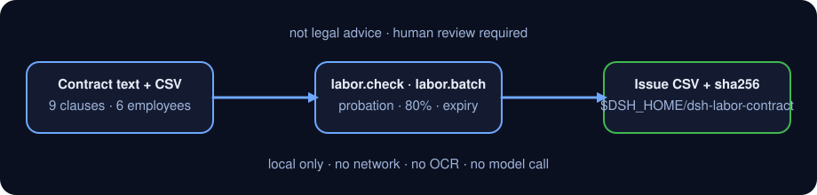

<div align="center">

# dsh-labor-contract

> **Official repository.** The only official repository of this package, maintained by PerryLink. Same-name repositories under other accounts are not affiliated. Apache-2.0.

[](https://www.npmjs.com/package/dsh-labor-contract)
[](https://github.com/PerryLink/dsh-labor-contract/actions)
[](LICENSE)

**Labor-contract clause coverage, probation cap, 80% probation-pay floor and batch expiry checks. Local only, not legal advice.**

> **Status: alpha / public-synthetic / partial / not counted / not GA.** No customer data, customer contracts or real employees; no production-readiness or legal-compliance claim.

[English](README.md) · [简体中文](README-zh.md)

```sh
dsh plugin --profile <profile> add dsh-labor-contract
```

</div>

## One-liner

Turn one labor-contract text and one employee CSV into a reviewable issue list: missing required clauses, probation over the statutory cap, probation pay below 80%, and contracts that expired or expire soon — then export the list as CSV.

> It checks **clause coverage, dates and ratios**. It is **not legal advice** and does not decide whether a clause is valid.

## Fit / not a fit

- **Fits:** pre-signing self-checks by HR or legal ops; batch checks for 6–500 employees; handing a structured issue list to a reviewer; feeding a contract register.
- **Does not fit:** replacing a lawyer; deciding validity, penalties, equity, confidentiality or IP ownership; reading PDFs, scans or DOCX directly (text only); checking local minimum wage, social-insurance base or payroll tax.

## Input

- `labor.check`: one labor-contract **plain text** (`.txt` or pasted body). Convert PDFs, scans or DOCX to text first; this package does no OCR and does not parse binary documents.
- `labor.batch`: a UTF-8 CSV with the fixed header
  `employee,position,contract_start,contract_end,probation_months,monthly_salary,probation_salary`.
  - `probation_salary` is optional; without it the 80% check is skipped.
  - Dates are `YYYY-MM-DD`; `contract_end` may also be `无固定期限`.
  - Amounts use `1234.56`; no `¥`, spaces or Chinese units.
- `labor.export`: an issue array (normally `labor.batch`'s `issues`) and a safe filename.
- All inputs are read-only.

## Output

- `labor.check`: `clauses` (9 items, each `present` / `attention` / `missing` with an evidence sentence and a hint), `summary`, `term`, `probation`, `probation_pay`, `non_compete`, and `disclaimer_zh`.
- `labor.batch`: `as_of`, `rows`, `issues`, `due.expired` / `due.expiring`, `summary.by_code`.
- `labor.export`: CSV path, row count, bytes and `sha256`, written under `$DSH_HOME/dsh-labor-contract/exports/`.
- Dates are `YYYY-MM-DD`; money is compared in integer cents to avoid floating-point drift.

## Example

Paste this line into the agent:

> 帮我核对这份劳动合同的必备条款、试用期上限和试用期工资比例，再把 6 名员工的合同批量查一遍到期和试用期问题。

Reproduce the bundled sample and compare with the golden file:

```sh
node samples/quickstart/run.mjs --check
```


The sample is one synthetic 36-month contract plus six synthetic employees: all nine clauses hit; a 3-month probation (cap 6 months); probation pay 10800 / 12000 = 90%; a two-year non-compete with monthly compensation. The batch reports four issues: one over-cap probation, one expired contract, one 79.99% probation wage, and one contract expiring in 74 days. `samples/quickstart/expected/result.json` is the real stdout of `node samples/quickstart/run.mjs --json`, not hand-written.

## Permissions

Read: the contract text and employee CSV the user names (sample: `samples/quickstart/input/`); nothing else.
Write: `$DSH_HOME/dsh-labor-contract/exports/` only (`labor.export`); source files are untouched.
Network: no.
External systems: none.

`labor.check` and `labor.batch` are **R0** (read-only). `labor.export` is **R1** (local write under `$DSH_HOME/dsh-labor-contract`). `DSH_LABOR_CONTRACT_HOME` can override the local write root for tests; the default is exactly `$DSH_HOME/dsh-labor-contract`.

## Tools

| Tool | Purpose | Risk |
|---|---|---|
| `labor.check` | Nine required clauses + probation cap + 80% probation pay + non-compete compensation prompt | R0 |
| `labor.batch` | CSV batch: over-cap probation, expired / 90-day expiring contracts, probation pay <80% | R0 |
| `labor.export` | Write the issue list as quoted CSV; return path and sha256 | R1 local write |

### Nine required clauses

Term, duties, location, hours/rest, pay, social insurance, labor protection, termination, dispute resolution.

Each item is one of:

- `present`: the clause and its specifics are visible (dates, position, city, amount, insurance types, notice/compensation, arbitration path).
- `attention`: the clause keyword exists but specifics are missing (for example a “Contract term” heading with no dates).
- `missing`: no keyword for that clause at all.

This is a keyword/pattern heuristic, **not** contract interpretation. A clause can look complete and still be invalid; a different drafting style can also be misclassified. Human review is required.

### Probation cap

Based on whole contract months (end date included):

| Contract term | Probation cap |
|---|---|
| Under 3 months | No probation |
| 3 months to under 1 year | 1 month |
| 1 year to under 3 years | 2 months |
| 3 years or more / open-ended | 6 months |
| Task-based completion | No probation |

Boundaries use inclusive whole months: 2026-01-01 to 2026-03-31 is 3 months; to 2026-03-30 is 2 whole months. If the term cannot be parsed the result is `unknown`, never a guess.

### 80% probation pay

`labor.check` extracts the probation wage and the regular monthly wage, then compares in cents: below 80% only when `probation × 100 < regular × 80`; exactly 80% passes. `labor.batch` applies the same rule per row. **The local minimum wage is a separate test this package cannot know** — check it for your city.

### Non-compete prompt

When “竞业限制 / 竞业禁止” appears, it checks whether monthly compensation is mentioned and whether the duration exceeds two years; either failure is `attention`. It does not judge whether the non-compete is enforceable.

### Batch expiry

With `as_of` (default today):

- `contract_end < as_of`: `CONTRACT_EXPIRED`, listed in `due.expired`.
- `0 ≤ contract_end - as_of ≤ 90`: `CONTRACT_EXPIRING`, listed in `due.expiring`.
- `contract_end = 无固定期限`: no expiry check; the probation cap is 6 months.

The 90-day window is this package's reminder default, not a statutory notice period. Change `EXPIRING_WINDOW_DAYS` in `src/core/labor.ts` and rebuild to tune it.

## CSV format

| Column | Required | Notes |
|---|---|---|
| `employee` | yes | Name or employee ID |
| `position` | yes | Job title |
| `contract_start` | yes | `YYYY-MM-DD` |
| `contract_end` | yes | `YYYY-MM-DD` or `无固定期限` |
| `probation_months` | yes | Non-negative integer, months |
| `monthly_salary` | yes | Agreed regular monthly wage in CNY, max 2 decimals |
| `probation_salary` | no | Probation monthly wage; omit to skip the 80% check |

```csv
employee,position,contract_start,contract_end,probation_months,monthly_salary,probation_salary
陈一（合成）,前端工程师,2026-01-01,2028-12-31,3,12000,10800
```

## FAQ

### 1. Is this legal advice?

No. It only checks clause coverage, dates and ratios and returns an explicit `disclaimer_zh`. Consult a qualified lawyer or your local human-resources/social-security authority for compliance decisions.

### 2. Can it read PDF / DOCX / scans?

No. It accepts plain text only. Convert the contract with a tool you trust first; scans also need OCR. This package never calls the network or an OCR service.

### 3. Are probation months calendar months or days?

Whole months with the end date included. `contractTermMonths` adds one day to the end, takes the month difference and corrects by day: 2026-01-01..2026-03-31 = 3 months. The probation value itself accepts months/days/years; days are converted at 30 days per month, so 45 days is compared as 1.5 months.

### 4. Is the 80% floor pre-tax or post-tax?

It compares the two amounts written in the contract, without tax, social insurance or housing-fund deductions. Use the same basis for `monthly_salary` and `probation_salary`.

### 5. Why a 90-day expiry window?

It is this package's default renewal reminder, not a statutory value. Change `EXPIRING_WINDOW_DAYS`, rebuild, then regenerate the golden file and screenshot.

### 6. Does it upload contracts or call a model?

No. All three tools are local code: no network, no upload, no model call. `labor.export` writes only under `$DSH_HOME/dsh-labor-contract/exports/`.

## Version

`0.1.0` · 31 tests pass (`node --test test/*.test.mjs`).

> ⭐ If this helps, a star makes it easier for the next person to find it. Nothing is gated behind it.



*Workflow: local contract text + employee CSV → clause/probation/80%/expiry checks → local issue CSV. No network, no model call.*

## Install

```sh
dsh plugin --profile <profile> add dsh-labor-contract
dsh --profile <profile> --dump-config | grep dsh-labor-contract
```

Uninstall:

```sh
dsh plugin --profile <profile> remove dsh-labor-contract
```

### Install channels

- **npm (recommended):** `dsh plugin --profile <profile> add dsh-labor-contract`
- **git channel:** `dsh plugin --profile <profile> add github:PerryLink/dsh-labor-contract`
- **tarball:** `pnpm pack`, then `dsh plugin --profile <profile> add ./dsh-labor-contract-<version>.tgz`

## Quick start

```sh
# 1) review one contract
#    tool surface: labor.check({ text: "<contract body>" })

# 2) batch-check
#    tool surface: labor.batch({ csv: "<CSV text>", as_of: "2026-11-02" })

# 3) export the issue list
#    tool surface: labor.export({ issues: [...batch.issues], filename: "labor-issues.csv" })
```

Or run the sample:

```sh
node samples/quickstart/run.mjs --check
```

## Acceptance evidence

Public/synthetic fixtures live in `samples/quickstart/`; `ACCEPTANCE.csv` records the checks. Every row is `counted=false` except the quickstart row.

| req_id | metric | threshold | actual | pass | source | counted |
|---|---|---|---|---|---|---|
| LABOR-A01 | nine required clauses present | 9/9 | 9/9 | true | public/synthetic | false |
| LABOR-A03 | probation cap boundary | ok/over/over | ok/over_limit/over_limit | true | public/synthetic | false |
| LABOR-A04 | 80% probation-pay boundary | ok/below_80 | ok/below_80 | true | public/synthetic | false |
| LABOR-A05 | 6-person batch issues | 4 | 6rows/4issues | true | public/synthetic | false |
| LABOR-A07 | invalid date error | E_LABOR_DATE_INVALID | E_LABOR_DATE_INVALID | true | public/synthetic | false |
| PS1-QS01 | quickstart golden | 1/1 | 1 | true | synthetic/quickstart | true |

*Fixture-backed rows, not a customer run; no output is invented.*

## Limits and known limitations

- **Not legal advice:** no validity, severance, penalty or enforceability determinations.
- **Text only:** no PDF/DOCX/OCR and no binary parsing.
- **Keyword heuristics:** synonyms, table layouts and merged clauses can misclassify `present` / `attention` / `missing`; human review is required.
- **Probation cap by term only:** does not model the “one probation per employer per employee” rule, dispatch staffing or part-time work.
- **80% compares two contract amounts:** local minimum wage, social-insurance base, tax and pre/post-tax basis are out of scope.
- **Non-compete is a prompt only:** no reasonableness test for scope, geography or role.
- **90-day window is a local default:** not a statutory notice period.
- **CSV uses RFC 4180 quoting only:** no Excel formula-prefix sanitisation; do not open untrusted CSVs directly in Excel.
- Public/synthetic samples only; alpha/partial, not counted, no GA or production-readiness claim.

## Development

```sh
pnpm install --frozen-lockfile
pnpm build && pnpm lint && pnpm typecheck
node --test test/*.test.mjs
node scripts/gate.mjs
```

## Compatibility

| Surface | Status |
|---|---|
| Harness | `dsh >=0.2.1-rc.3 <0.4.0` |
| Node | `>=24.9.0 <25` |
| Platforms | All; local files only |
| Data | No network, no model call, no upload |

## Related work

- [dsh-legal-intake](https://github.com/PerryLink/dsh-legal-intake) — legal request intake and ledger
- [dsh-contract-renewal](https://github.com/PerryLink/dsh-contract-renewal) — contract expiry / renewal-window register
- [dsh-pim-lint](https://github.com/PerryLink/dsh-pim-lint) — CSV validation tools
- [Domain index](https://perrylink.github.io/dsh-plugins/)

## License

Apache-2.0. See `LICENSE`, `NOTICE`, `THIRD-PARTY-NOTICES`.
