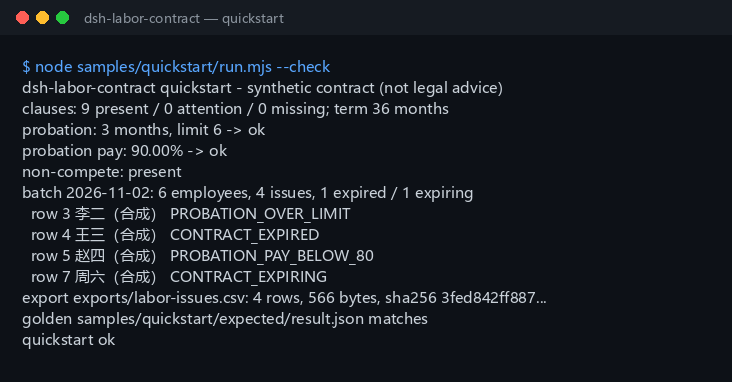

<div align="center">

<picture>
  <source media="(prefers-color-scheme: dark)" srcset="docs/assets/dsh-labor-contract-hero-en-dark.webp">
  
</picture>

# dsh-labor-contract

**Transforme um texto de contrato de trabalho e um CSV de funcionários numa lista de problemas revisável: cláusulas obrigatórias ausentes, período de experiência acima do limite, salário de experiência abaixo de 80% e contratos vencidos ou a vencer; depois exporte a lista como CSV.**

Um plugin de revisão de contratos puramente local para RH e operações jurídicas: nove cláusulas obrigatórias, limite do período de experiência, piso de 80% do salário de experiência, vencimento em lote e aviso de compensação por não concorrência, com exportação CSV assinada com sha256 — sem rede, sem chamadas a modelos e sem aconselhamento jurídico.

[Instalar](#instalação-em-três-passos) · [Configuração](#configuração) · [FAQ](#faq) · [简体中文](README.md) · [English](README.en.md) · [Español](README.es.md) · [Português](README.pt.md) · [हिन्दी](README.hi.md)

[](LICENSE)
[](#compatibilidade)
[](https://www.npmjs.com/package/dsh-labor-contract)
[](https://github.com/PerryLink/dsh-labor-contract/actions/workflows/ci.yml)
[](#compatibilidade)

[](https://github.com/PerryLink/dsh-labor-contract/stargazers)
[](https://www.npmjs.com/package/dsh-labor-contract)
[](https://dshfind.com/plugins/PerryLink/dsh-labor-contract?ref=badge)
[](https://gitee.com/perrylink/dsh-labor-contract)

```sh
dsh plugin --profile <profile> add dsh-labor-contract
```

</div>

<sub>Plugin da comunidade, sem afiliação com a DeepSeek. Repositório canônico: <https://github.com/PerryLink/dsh-labor-contract> (o Gitee é um espelho). Status: alfa / sintético-público / parcial / not counted / não GA — sem contratos de clientes nem dados de funcionários reais, e sem declarações de prontidão para produção ou conformidade legal.</sub>

## O que é

O `dsh-labor-contract` lê um contrato de trabalho em texto simples, verifica a cobertura das nove cláusulas obrigatórias, calcula o limite do período de experiência a partir da duração do contrato, compara o salário de experiência com o piso de 80% e avisa sobre a compensação e o prazo de dois anos nas cláusulas de não concorrência. Também revisa em lote um CSV de contratos de funcionários: período de experiência acima do limite, contratos vencidos ou a vencer em 90 dias e salário de experiência abaixo de 80%. Por fim grava a lista de problemas como CSV com um recibo `sha256`.

Ele verifica apenas **cobertura de cláusulas, datas e proporções**: tudo roda na sua máquina, os arquivos de origem são somente leitura e não há rede nem chamadas a modelos.

- **Serve para:** autoverificação estruturada antes da assinatura por RH ou operações jurídicas; revisões em lote de 6–500 funcionários; entregar uma lista de problemas estruturada a um revisor; alimentar um registro de contratos.
- **Não serve para:** substituir um advogado; decidir validade, multas, equity, confidencialidade ou titularidade de propriedade intelectual; ler PDF, digitalizações ou DOCX diretamente (só texto); conferir o salário mínimo local, a base da previdência ou os impostos sobre a folha.

<picture>
  <source media="(prefers-color-scheme: dark)" srcset="docs/assets/dsh-labor-contract-flow-v5-dark.svg">
  
</picture>

## Instalação em três passos

1. **Instale** (escolha um canal):

   ```sh
   # canal npm (recomendado, versões publicadas)
   dsh plugin --profile <profile> add dsh-labor-contract
   # canal git (main mais recente; equivale a git+https://github.com/PerryLink/dsh-labor-contract.git)
   dsh plugin --profile <profile> add github:PerryLink/dsh-labor-contract
   # canal tarball: pnpm pack neste repo e depois
   dsh plugin --profile <profile> add ./dsh-labor-contract-<version>.tgz
   ```

   Não há etapa de build; o `lib/` instalado é o artefato publicado.

2. **Verifique que está ativo**:

   ```sh
   dsh --profile <profile> --dump-config | grep dsh-labor-contract
   ```

3. **Execute o exemplo incluído** (rode `pnpm build` neste repo primeiro; um contrato sintético de 36 meses + seis funcionários sintéticos, comparado com o arquivo dourado):

   ```sh
   node samples/quickstart/run.mjs --check
   ```

**Desinstalar:** `dsh plugin --profile <profile> remove dsh-labor-contract` (ou apague a linha do patch do perfil).

## Capacidades principais

Os nomes das ferramentas são API estável; as descrições permanecem em inglês para coincidir com a saída em tempo de execução.

| Ferramenta | Propósito | Risco |
|---|---|---|
| `labor.check` | Um contrato: nove cláusulas obrigatórias + limite do período de experiência + salário de experiência a 80% + aviso de compensação por não concorrência | R0 (somente leitura) |
| `labor.batch` | Lote CSV: período de experiência acima do limite, contratos vencidos / a vencer em 90 dias, salário de experiência abaixo de 80% | R0 (somente leitura) |
| `labor.export` | Grava a lista de problemas como CSV com aspas; devolve caminho e sha256 | R1 (gravação local apenas em exports) |

- **Nove cláusulas obrigatórias:** prazo, funções, local, jornada/descanso, salário, previdência, proteção do trabalho, rescisão e resolução de conflitos, cada uma com frase de evidência e `present` / `attention` / `missing`.
- **Limite do período de experiência:** 0 / 1 / 2 / 6 meses por meses inteiros de contrato (com a data de fim incluída); devolve `unknown` em vez de adivinhar quando não consegue interpretar o prazo.
- **Salário de experiência a 80%:** comparação em centavos; exatamente 80% passa, só abaixo é `below_80`.
- **Vencimento em lote:** códigos `CONTRACT_EXPIRED` e `CONTRACT_EXPIRING` com janela de aviso de 90 dias por padrão.
- **Aviso de não concorrência:** verifica se há compensação mensal e se o prazo passa de dois anos; não julga se é exigível.
- **Entregável revisável:** o CSV exportado traz `sha256` e é gravado em `$DSH_HOME/dsh-labor-contract/exports/`.

## Exemplo

Cole esta linha no agente:

```text
帮我核对这份劳动合同的必备条款、试用期上限和试用期工资比例，再把 6 名员工的合同批量查一遍到期和试用期问题。
```

Ou chame a superfície de ferramentas diretamente:

```sh
# 1) revisar um contrato
#    superfície: labor.check({ text: "<corpo do contrato>" })

# 2) revisão em lote
#    superfície: labor.batch({ csv: "<texto CSV>", as_of: "2026-11-02" })

# 3) exportar a lista de problemas
#    superfície: labor.export({ issues: [...batch.issues], filename: "labor-issues.csv" })
```

Reproduza o exemplo incluído e compare com o arquivo dourado:

```sh
node samples/quickstart/run.mjs --check
```



O exemplo é um contrato sintético de 36 meses mais seis funcionários sintéticos: as nove cláusulas aparecem; período de experiência de 3 meses (limite 6 meses); salário de experiência 10800 / 12000 = 90%; não concorrência de dois anos com compensação mensal. O lote devolve quatro problemas: um período de experiência acima do limite, um contrato vencido, um salário de experiência de 79,99% e um contrato que vence em 74 dias. `samples/quickstart/expected/result.json` é a saída real de `node samples/quickstart/run.mjs --json`, não escrita à mão; a captura é a saída real de terminal de `--check` (captura bruta em [`docs/assets/quickstart.log`](docs/assets/quickstart.log)).

## Entrada

- `labor.check`: um contrato de trabalho em **texto simples** (`.txt` ou corpo colado). Converta antes PDF, digitalizações ou DOCX com uma ferramenta de confiança; este pacote não faz OCR nem analisa documentos binários.
- `labor.batch`: um CSV UTF-8 com o cabeçalho fixo
  `employee,position,contract_start,contract_end,probation_months,monthly_salary,probation_salary`.
  - `probation_salary` é opcional; sem ela a verificação dos 80% é ignorada.
  - As datas são `YYYY-MM-DD`; `contract_end` também aceita a palavra-chave chinesa para contrato por prazo indeterminado.
  - Os valores usam `1234.56`; sem `¥`, espaços ou unidades chinesas.
- `labor.export`: um array de problemas (normalmente `issues` de `labor.batch`) e um nome de arquivo seguro.
- Todas as entradas são somente leitura.

Valores aceitos de `contract_end`:

```text
2026-12-31
无固定期限
```

| Coluna | Obrigatória | Notas |
|---|---|---|
| `employee` | sim | Nome ou número do funcionário |
| `position` | sim | Cargo |
| `contract_start` | sim | `YYYY-MM-DD` |
| `contract_end` | sim | `YYYY-MM-DD` ou a palavra-chave de prazo indeterminado |
| `probation_months` | sim | Inteiro não negativo, meses |
| `monthly_salary` | sim | Salário mensal acordado em CNY, no máximo 2 casas decimais |
| `probation_salary` | não | Salário mensal de experiência; omita para pular a verificação dos 80% |

```csv
employee,position,contract_start,contract_end,probation_months,monthly_salary,probation_salary
陈一（合成）,前端工程师,2026-01-01,2028-12-31,3,12000,10800
```

## Saída

- `labor.check`: `clauses` (9 itens, cada um `present` / `attention` / `missing` com frase de evidência e uma dica), `summary`, `term`, `probation`, `probation_pay`, `non_compete` e `disclaimer_zh`.
- `labor.batch`: `as_of`, `rows`, `issues`, `due.expired` / `due.expiring`, `summary.by_code`.
- `labor.export`: caminho do CSV, número de linhas, bytes e `sha256`, gravado em `$DSH_HOME/dsh-labor-contract/exports/`.
- As datas são `YYYY-MM-DD`; o dinheiro é comparado em centavos inteiros para evitar desvios de ponto flutuante.

## Regras de decisão

### Nove cláusulas obrigatórias

Prazo, funções, local, jornada/descanso, salário, previdência, proteção do trabalho, rescisão e resolução de conflitos.

Cada item é um de:

- `present`: a cláusula e seus detalhes estão visíveis (datas, cargo, cidade, valor, tipos de seguro, aviso/prêmio, via de arbitragem).
- `attention`: a palavra-chave existe, mas faltam detalhes (por exemplo, um título «Prazo do contrato» sem datas).
- `missing`: nenhuma palavra-chave daquela cláusula aparece.

É uma heurística de palavras-chave e padrões, **não** interpretação contratual. Uma cláusula pode parecer completa e ainda ser inválida; outro estilo de redação também pode ser classificado errado. A revisão humana é obrigatória.

### Limite do período de experiência

Com base nos meses inteiros do contrato (com a data de fim incluída):

| Prazo do contrato | Limite do período de experiência |
|---|---|
| Menos de 3 meses | Sem período de experiência |
| De 3 meses a menos de 1 ano | 1 mês |
| De 1 ano a menos de 3 anos | 2 meses |
| 3 anos ou mais / indeterminado | 6 meses |
| Por obra ou tarefa determinada | Sem período de experiência |

Os limites usam meses inteiros inclusivos: 2026-01-01 a 2026-03-31 são 3 meses; a 2026-03-30 são 2 meses inteiros. Se o prazo não puder ser interpretado, o resultado é `unknown`, nunca um palpite.

### Salário de experiência a 80%

`labor.check` extrai o salário de experiência e o salário mensal acordado e compara em centavos: abaixo de 80% apenas quando `experiência × 100 < acordado × 80`; exatamente 80% passa. `labor.batch` aplica a mesma regra por linha. **O salário mínimo local é uma verificação separada que este pacote não conhece** — confira para a sua cidade.

### Aviso de não concorrência

Quando detecta uma cláusula de não concorrência, verifica se há compensação mensal e se o prazo passa de dois anos; qualquer falha é `attention`. Não julga se a cláusula é exigível.

### Vencimento em lote

Com `as_of` (padrão hoje):

- `contract_end < as_of`: `CONTRACT_EXPIRED`, em `due.expired`.
- `0 ≤ contract_end - as_of ≤ 90`: `CONTRACT_EXPIRING`, em `due.expiring`.
- `contract_end` é a palavra-chave de prazo indeterminado: sem verificação de vencimento; o limite do período de experiência é 6 meses.

A janela de 90 dias é o lembrete padrão do pacote, não um prazo legal de aviso prévio. Altere `EXPIRING_WINDOW_DAYS` em `src/core/labor.ts` e recompile para ajustar.

## Configuração

Este plugin não tem chaves de configuração no nível do perfil (`cordis.patch.yml` apenas insere o próprio plugin); todo ajuste é um parâmetro de ferramenta por chamada:

```yaml
- insert:
    - id: dsh-labor-contract
      name: 'dsh-labor-contract'
```

| Parâmetro | Valor padrão | Significado |
|---|---|---|
| `text` | (obrigatório, `labor.check`) | Texto simples do contrato de trabalho; somente leitura, sem OCR |
| `csv` | (obrigatório, `labor.batch`) | Texto CSV de contratos de funcionários, cabeçalho fixo, separado por vírgulas |
| `as_of` | hoje | Data de referência de vencimento de `labor.batch`, `YYYY-MM-DD` |
| `issues` | (obrigatório, `labor.export`) | Array de problemas, normalmente `issues` de `labor.batch` |
| `filename` | derivado da data | Nome de arquivo de `labor.export`, apenas `[A-Za-z0-9._-]`; sempre em `$DSH_HOME/dsh-labor-contract/exports/` |

## FAQ

<details>
<summary>Isto é aconselhamento jurídico?</summary>

Não. Ele apenas verifica cobertura de cláusulas, datas e proporções e devolve um `disclaimer_zh` explícito. Consulte um advogado qualificado ou a autoridade trabalhista da sua região para decisões de conformidade.

</details>

<details>
<summary>Ele consegue ler PDF / DOCX / digitalizações?</summary>

Não. Aceita apenas texto simples. Converta antes o contrato com uma ferramenta de confiança; digitalizações ainda precisam de OCR. Este pacote nunca chama a rede nem um serviço de OCR.

</details>

<details>
<summary>Os meses de experiência são meses corridos ou dias?</summary>

Meses inteiros com a data de fim incluída. `contractTermMonths` soma um dia ao fim, calcula a diferença de meses e corrige por dias: 2026-01-01..2026-03-31 = 3 meses. O valor de experiência aceita meses/dias/anos; dias são convertidos a 30 dias por mês, então 45 dias são comparados como 1,5 mês.

</details>

<details>
<summary>O piso de 80% é antes ou depois de impostos?</summary>

Compara os dois valores escritos no contrato, sem impostos, previdência ou descontos de moradia. Use a mesma base para `monthly_salary` e `probation_salary`.

</details>

<details>
<summary>Por que uma janela de vencimento de 90 dias?</summary>

É o lembrete de renovação padrão do pacote, não um valor legal. Altere `EXPIRING_WINDOW_DAYS` em `src/core/labor.ts`, recompile e gere novamente o arquivo dourado e a captura.

</details>

<details>
<summary>Ele envia contratos ou chama um modelo?</summary>

Não. As três ferramentas são código local: sem rede, sem upload, sem chamadas a modelos. `labor.export` grava apenas em `$DSH_HOME/dsh-labor-contract/exports/`.

</details>

## Permissões e dados

- **Leitura:** o texto do contrato e o CSV de funcionários indicados pelo usuário (exemplo: `samples/quickstart/input/`); nada mais.
- **Gravação:** apenas `$DSH_HOME/dsh-labor-contract/exports/` (`labor.export`); os arquivos de origem não são tocados.
- **Rede:** não.
- **Sistemas externos:** nenhum.

`labor.check` e `labor.batch` são **R0** (somente leitura). `labor.export` é **R1** (gravação local em `$DSH_HOME/dsh-labor-contract`). `DSH_LABOR_CONTRACT_HOME` pode sobrescrever a raiz de gravação local para testes; o padrão é exatamente `$DSH_HOME/dsh-labor-contract`.

## Limitações conhecidas

- **Não é aconselhamento jurídico:** sem determinações de validade, verbas rescisórias, multas ou exigibilidade.
- **Somente texto:** sem PDF/DOCX/OCR e sem análise de binários.
- **Heurística de palavras-chave:** sinônimos, tabelas e cláusulas fundidas podem classificar errado `present` / `attention` / `missing`; a revisão humana é obrigatória.
- **Limite de experiência só pelo prazo:** não modela a regra de «um único período de experiência por empregador e empregado», trabalho temporário ou tempo parcial.
- **Os 80% comparam dois valores do contrato:** salário mínimo local, base da previdência, impostos e base antes/depois de impostos ficam fora do escopo.
- **A não concorrência é só um aviso:** sem teste de razoabilidade de escopo, geografia ou função.
- **A janela de 90 dias é local:** não é um prazo legal de aviso prévio.
- **O CSV usa apenas aspas RFC 4180:** sem saneamento de prefixos de fórmula do Excel; não abra CSV de origem desconhecida diretamente no Excel.
- **Apenas amostras públicas/sintéticas:** alfa/parcial, not counted, sem declaração de GA ou de produção.

## Evidência de aceitação

Os fixtures públicos/sintéticos ficam em `samples/quickstart/`; `ACCEPTANCE.csv` registra nove verificações públicas mais uma linha dourada de quickstart. Todas as linhas são `counted=false` exceto a de quickstart.

| req_id | metric | threshold | actual | pass | source | counted |
|---|---|---|---|---|---|---|
| LABOR-A01 | nine required clauses present | 9/9 | 9/9 | true | public/synthetic | false |
| LABOR-A02 | missing clauses detected | 9 | 9 | true | public/synthetic | false |
| LABOR-A03 | probation cap boundary | ok/over/over | ok/over_limit/over_limit | true | public/synthetic | false |
| LABOR-A04 | 80% probation-pay boundary | ok/below_80 | ok/below_80 | true | public/synthetic | false |
| LABOR-A05 | 6-person batch issues | 4 | 6rows/4issues | true | public/synthetic | false |
| LABOR-A06 | expiry window | 1expired/1expiring | 1expired/1expiring | true | public/synthetic | false |
| LABOR-A07 | invalid date error | E_LABOR_DATE_INVALID | E_LABOR_DATE_INVALID | true | public/synthetic | false |
| LABOR-A08 | export path safety | E_LABOR_PATH_INVALID | E_LABOR_PATH_INVALID | true | public/synthetic | false |
| LABOR-A09 | export sha256/bytes | matches file | ok | true | public/synthetic | false |
| PS1-QS01 | quickstart golden | 1/1 | 1 | true | synthetic/quickstart | true |

*Linhas respaldadas por fixtures, não uma execução de cliente; nenhuma saída é inventada.* Veja [EVIDENCE.md](EVIDENCE.md) para o ambiente e os resultados por comando; execuções anteriores ficam em `evidence/`.

## Compatibilidade

| Superfície | Status |
|---|---|
| Harness | `dsh >=0.2.1-rc.3 <0.4.0` |
| Node | `>=24.9.0 <25` |
| Plataformas | Todas; apenas arquivos locais |
| Dados | Sem rede, sem chamadas a modelos, sem upload |

## Ecossistema e qualidade

- [Espelho do Gitee](https://gitee.com/perrylink/dsh-labor-contract) (espelho sincronizado; o GitHub é o canônico)
- [Página do plugin no dshfind](https://dshfind.com/plugins/PerryLink/dsh-labor-contract) (instalações e classificação)
- [Índice de domínio](https://perrylink.github.io/dsh-plugins/) (o catálogo de plugins da PerryLink)
- Plugins relacionados da família: [dsh-legal-intake](https://github.com/PerryLink/dsh-legal-intake) (entrada e livro de solicitações jurídicas), [dsh-contract-renewal](https://github.com/PerryLink/dsh-contract-renewal) (vencimento / janela de renovação), [dsh-pim-lint](https://github.com/PerryLink/dsh-pim-lint) (ferramentas de validação de CSV)

## Desenvolvimento

```sh
pnpm install --frozen-lockfile
pnpm build && pnpm lint && pnpm typecheck
node --test test/*.test.mjs
node scripts/gate.mjs
```

Versão atual `0.1.0` · 31 testes passam (`node --test test/*.test.mjs`). As imagens do README são geradas programaticamente por [`scripts/gen-readme-assets.py`](scripts/gen-readme-assets.py) (Python/Pillow; o banner hero é um webp de 1440x576 em zh/en x claro/escuro, o diagrama de estrutura é um SVG escrito à mão de 1100x660 nas variantes clara e escura, e seus números vêm do arquivo dourado do quickstart) e pode ser reexecutado a qualquer momento.

Topics: `deepseek-harness`, `dsh`, `dsh-plugin`, `labor`, `contract`, `hr`, `probation`, `compliance`, `perrylink`

## Família e agradecimentos

Este projeto é membro da família de plugins do DeepSeek Harness mantida pela [PerryLink](https://github.com/PerryLink) (todos Apache-2.0). Se este plugin ajudar você, **uma estrela facilita que a próxima pessoa o encontre** — nada fica bloqueado por trás dela.

- [@PerryLink](https://github.com/PerryLink) — criador e mantenedor: cobertura de cláusulas, limite do período de experiência e verificações dos 80%, o pipeline de vencimento em lote, o exemplo dourado de quickstart com sua evidência de aceitação e a documentação em cinco idiomas.

## Licença

[LICENSE](LICENSE) (Apache License 2.0) © 2026 dsh-labor-contract contributors. Veja também `NOTICE` e `THIRD-PARTY-NOTICES`.

<p align="center"><sub>Apache-2.0 · Plugin da comunidade, sem afiliação com a DeepSeek.</sub></p>
